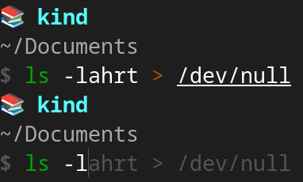
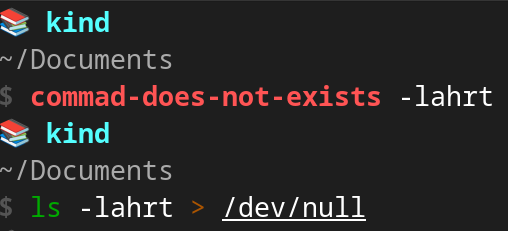
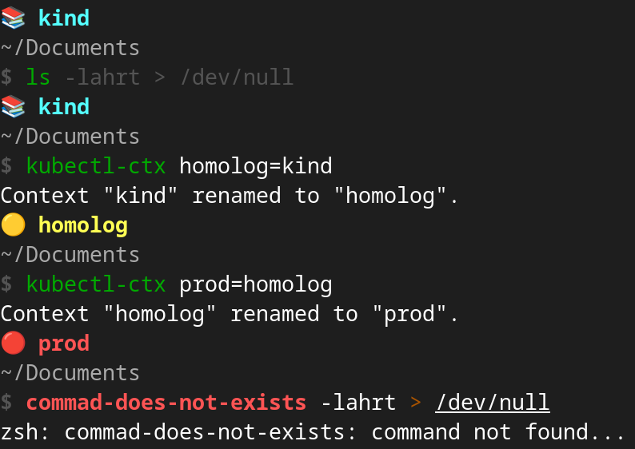

*__Blog Post Publish Date:__ 2024/02/08*

---

# ZSH + Starship: A Productivity Masterpiece

This blog post covers how I ended up with [ZSH](https://www.zsh.org/) and [Starship](https://starship.rs/) as my terminal setup. It walks through the shells I tried along the way, my favorite ZSH plugins and [ZSH options](https://zsh.sourceforge.io/Doc/Release/Options.html), my minimal Starship configuration, and a step-by-step guide to reproduce it from scratch.

## The Shells I Tried

Productivity is a topic I really enjoy. For a long time, I used a plain Bash terminal. It forced me to memorize commands, but it did not make me productive, so I decided to improve my setup.

### __xonsh__: Python + Bash Advantages (_and Disadvantages_)

Because I work a lot with Python, I used [xonsh](https://xon.sh/) for about six months. **xonsh** is a superset of Python with extra shell primitives that Bash users already know. Mixing Python syntax with Bash commands is productive, but debugging can get hard. Imagine a Python list comprehension combined with dictionaries and Bash environment variables in the same line.

### __zsh__: Extensible and Production-Ready (_If Customized_)

I wanted to come back to a more conventional shell, so I gave ZSH a chance. **ZSH** is a highly customizable shell with a large plugin ecosystem. It won me over, especially with [Spaceship](https://github.com/spaceship-prompt/spaceship-prompt), a _"minimalistic, powerful and extremely customizable ZSH prompt"_, and [oh-my-zsh](https://ohmyz.sh/), a framework that manages plugins and themes. I thought I had found a stable balance between productivity and simplicity, but on my macOS workstation, the input and startup delay got on my nerves.

I searched blog posts and YouTube videos for tips, but nothing fixed it. So I installed the plugins manually, without oh-my-zsh, and tried [Starship](https://starship.rs/). In my words, Starship is "_a Spaceship alternative, written in Rust, blazing fast, with many stars on GitHub_".

The results were great. Moving my theme from Spaceship to Starship took almost no effort, and the performance was exactly what I wanted.

### __fish__: Ready to Use (_But Not POSIX-Compliant_)

More recently, I tried [Fish](https://fishshell.com/), described as "_a smart and user-friendly command line shell_". Its performance and default features impressed me, and Starship supports it too. Out of the box, Fish already has syntax checking with color indicators, autosuggestions based on history, and a selection menu for command options and arguments. It's simple and ready to use.

The drawback is that Fish does not follow the [POSIX sh definition](http://pubs.opengroup.org/onlinepubs/009695399/utilities/xcu_chap02.html). For example, `$ FOOBAR=123` does not declare a variable. You have to write `$ set FOOBAR 123` instead. That rules Fish out of my daily work, but if ZSH were not an option, I would happily use it.

## My Favorite ZSH Plugins

ZSH has a huge number of plugins. They are usually installed and managed by [oh-my-zsh](https://ohmyz.sh/), but you can install them directly, because a plugin is just a script file with a set of functions. These are the ones I can't work without.

### __zsh-autosuggestions__: Remembers Commands for You

This is my favorite plugin, no doubt. It copies a Fish feature: as you type, it suggests a completion based on your history.



> <i class="fa-solid fa-link"></i> More Details: <https://github.com/zsh-users/zsh-autosuggestions>

### __zsh-syntax-highlighting__: Valid Commands by Color

Another plugin inspired by Fish. When a command is typed correctly, it turns green. Otherwise, it turns red, so you catch typos before pressing Enter.



> <i class="fa-solid fa-link"></i> More Details: <https://github.com/zsh-users/zsh-syntax-highlighting/blob/master/>

### __kubectl__: The `k` Alias for kubectl

This plugin adds Kubernetes completion and short aliases for common `kubectl` commands. For example:

```{code-block} bash
# shortcut for: kubectl get pods
$ kgp

# shortcut for: kubectl delete cm foobar-config-map
$ kdelcm foobar-config-map

# shortcut for: kubectl get cronjob
$ k get cj
```

> <i class="fa-solid fa-link"></i> More Details: <i class="fab fa-github"></i> [ohmyzsh/ohmyzsh/plugins/kubectl](https://github.com/ohmyzsh/ohmyzsh/tree/master/plugins/kubectl)

I use the same kind of aliases when I study for the Kubernetes certifications. My [workstation setup for the CKA, CKAD, and CKS exams](/blog/2026/2026-07-09-workstation-setup-kubernetes-exams.md) covers the ones that save the most time.

## My Starship Configuration

Simplicity is elegance. My Starship prompt shows only the information I care about:

- [aws](https://starship.rs/config/#aws): only the profile name of my AWS session.
- [git](https://starship.rs/config/#git-branch): only the branch, nothing else.
- [python](https://starship.rs/config/#python): the active virtualenv.
- [kubernetes](https://starship.rs/config/#kubernetes): the Kubernetes context name. I style it differently depending on the name, so study, test, and production clusters are easy to tell apart.

> My full `~/.config/starship.toml`: <i class="fab fa-github"></i> [c-neto/ansible-configure-fedora/files/dotfiles/starship.toml](https://github.com/c-neto/ansible-configure-fedora/tree/main/files/dotfiles/starship.toml)

## My Favorite ZSH Options (_setopt_)

Some features that Bash or Fish have by default, such as comments in the prompt or sharing history, must be enabled explicitly in ZSH. You enable them with `setopt` in `~/.zshrc`. Running `$ set -o` lists every option and whether it's on, and the [ZSH Options Reference](https://zsh.sourceforge.io/Doc/Release/Options.html) describes each one.

These are the options I enable:

- `INTERACTIVE_COMMENTS`: allows `#` comments in the interactive shell.
- `APPEND_HISTORY`: appends new entries to the history file instead of overwriting it.
- `INC_APPEND_HISTORY`: writes each command to the history file as soon as it runs.
- `HIST_IGNORE_DUPS`: does not record a command that repeats the previous one, which also makes zsh-autosuggestions faster.
- `HIST_IGNORE_SPACE`: does not record commands that start with a space.

> My full `~/.zshrc`: <i class="fab fa-github"></i> [c-neto/ansible-configure-fedora/files/dotfiles/.zshrc](https://github.com/c-neto/ansible-configure-fedora/tree/main/files/dotfiles/.zshrc)

## How to Set Up My ZSH + Starship From Scratch

All my dotfiles are on GitHub: <i class="fab fa-github"></i> [c-neto/ansible-configure-fedora/files/dotfiles/](https://github.com/c-neto/ansible-configure-fedora/tree/main/files/dotfiles/)

- __1__ _optional_: Back up your current dotfiles (`~/.zshrc` and `~/.zsh_history`):

```{code-block} bash
$ cp "$HOME/.zshrc" "$HOME/.zshrc.backup"
$ cp "$HOME/.zsh_history" "$HOME/.zsh_history.backup"
```

- __2__: Install [ZSH](https://www.zsh.org/) with your package manager.

::::{grid}

:::{grid-item-card}
```{code-block} bash
# if Linux (Fedora)
$ dnf install zsh
```
:::

:::{grid-item-card}
```{code-block} bash
# if MacOS
$ brew install zsh
```
:::

::::

- __3__: Install [Starship](https://starship.rs/):

```{code-block} bash
$ curl -sS https://starship.rs/install.sh | sh
```

> <i class="fa-solid fa-circle-info"></i> __About Nerd Fonts__:
>
> The `~/.config/starship.toml` file from step __5__ does not need [Nerd Fonts](https://www.nerdfonts.com/). If emojis don't render correctly, installing one may help.

- __4__: Create the directories for the ZSH plugins and the Starship configuration:

```{code-block} bash
$ mkdir "$HOME/.config/"
$ mkdir "$HOME/.my-custom-zsh/"
```

- __5__: Download my <i class="fab fa-github"></i> [~/.config/starship.toml](https://github.com/c-neto/ansible-configure-fedora/tree/main/files/dotfiles/starship.toml):

```{code-block} bash
$ curl 'https://raw.githubusercontent.com/c-neto/ansible-configure-fedora/main/files/dotfiles/starship.toml' > "$HOME/.config/starship.toml"
```

- __6__: Install the plugins manually:

```{code-block} bash
# k alias
$ curl 'https://raw.githubusercontent.com/ohmyzsh/ohmyzsh/master/plugins/kubectl/kubectl.plugin.zsh' > "$HOME/.my-custom-zsh/kubectl.plugin.zsh"

# zsh-syntax-highlighting
$ git clone --depth 1 'https://github.com/zsh-users/zsh-syntax-highlighting.git' "$HOME/.my-custom-zsh/zsh-syntax-highlighting"

# zsh-autosuggestions
$ git clone --depth 1 'https://github.com/zsh-users/zsh-autosuggestions' "$HOME/.my-custom-zsh/zsh-autosuggestions"
```

- __7__: Download my <i class="fab fa-github"></i> [~/.zshrc](https://github.com/c-neto/ansible-configure-fedora/tree/main/files/dotfiles/.zshrc):

```{code-block} bash
$ curl 'https://raw.githubusercontent.com/c-neto/ansible-configure-fedora/main/files/dotfiles/.zshrc' > "$HOME/.zshrc"
```

> <i class="fa-solid fa-circle-info"></i> __Key Binding Tip__
>
> You can change the `bindkey` values to your preference. To find the code for a key, run `$ cat -v` and press the key: its code appears in the shell. Then map functions such as `forward-word` and `backward-word` to that code.
>
> More details about the bindkey standard widgets: <https://zsh.sourceforge.io/Doc/Release/Zsh-Line-Editor.html#Zle-Widgets>

- __8__: Restart your terminal. The result looks like this:



## Why I Settled on ZSH + Starship

Productivity is a moving target. Tools should fit what you need now, and it's fine to change them when your work changes.

For my DevOps routine today, ZSH with Starship is a balanced, cross-platform choice with good performance, productivity, and room to extend. If you want to go further, ZSH also lets you write your own key bindings, which I cover in [Hacking Your Zsh Terminal with Custom Widgets](/blog/2026/2026-10-26-zsh-widgets.md), and [fzf](/blog/2024/2024-04-21-fzf.md) turns history and file search into an interactive menu.

Fish still gets an honorable mention: its default configuration inspired most of the plugins I use in ZSH.

## Key Takeaways

- xonsh mixes Python and Bash productively, but debugging mixed syntax gets hard.
- oh-my-zsh is convenient, but on my macOS machine it made startup and input noticeably slow. Installing plugins manually fixed that.
- Starship is a fast, Rust-based prompt that replaced Spaceship with almost no configuration changes.
- Fish is excellent out of the box, but it is not POSIX-compliant, which rules it out for my daily work.
- zsh-autosuggestions, zsh-syntax-highlighting, and the kubectl plugin bring Fish-like features and Kubernetes aliases to ZSH.
- Enable `INTERACTIVE_COMMENTS` and the history options with `setopt` in `~/.zshrc`.
- Keep the prompt minimal: show only the context you check all the time, such as git branch, AWS profile, virtualenv, and Kubernetes context.

## References

- [ZSH (zsh.org)](https://www.zsh.org/)
- [Options (ZSH manual)](https://zsh.sourceforge.io/Doc/Release/Options.html)
- [Zle widgets (ZSH manual)](https://zsh.sourceforge.io/Doc/Release/Zsh-Line-Editor.html#Zle-Widgets)
- [Starship (starship.rs)](https://starship.rs/)
- [Starship source (GitHub)](https://github.com/starship/starship)
- [zsh-autosuggestions (GitHub)](https://github.com/zsh-users/zsh-autosuggestions)
- [zsh-syntax-highlighting (GitHub)](https://github.com/zsh-users/zsh-syntax-highlighting)
- [kubectl plugin (oh-my-zsh)](https://github.com/ohmyzsh/ohmyzsh/tree/master/plugins/kubectl)
- [xonsh (xon.sh)](https://xon.sh/)
- [oh-my-zsh (ohmyz.sh)](https://ohmyz.sh/)
- [Spaceship prompt (GitHub)](https://github.com/spaceship-prompt/spaceship-prompt)
- [Shell Command Language (POSIX)](http://pubs.opengroup.org/onlinepubs/009695399/utilities/xcu_chap02.html)
- My dotfiles: [`.zshrc`](https://github.com/c-neto/ansible-configure-fedora/tree/main/files/dotfiles/.zshrc) and [`starship.toml`](https://github.com/c-neto/ansible-configure-fedora/tree/main/files/dotfiles/starship.toml)

*I'm Carlos Neto, and this blog is where I share my experiences and open source contributions. More about me on [my home page](/index.md). If you have questions or a different approach, contact me on [LinkedIn](https://www.linkedin.com/in/c-neto/).*

---

```{raw} html
<script type="application/ld+json">
{
  "@context": "https://schema.org",
  "@graph": [
    {
      "@type": "BlogPosting",
      "headline": "ZSH + Starship: A Productivity Masterpiece",
      "description": "My path from Bash through xonsh, oh-my-zsh, and Fish to ZSH with Starship: the plugins and setopt options I rely on, my minimal Starship prompt, and a step-by-step guide to reproduce the setup.",
      "datePublished": "2024-02-08",
      "inLanguage": "en",
      "url": "https://carlosneto.dev/blog/2024/2024-02-08-starship-zsh/",
      "mainEntityOfPage": "https://carlosneto.dev/blog/2024/2024-02-08-starship-zsh/",
      "image": "https://carlosneto.dev/_static/2024/2024-02-08/image-3.png",
      "keywords": ["ZSH", "Starship", "terminal", "zsh plugins", "dotfiles"],
      "author": {"@id": "https://carlosneto.dev/#person"}
    },
    {
      "@type": "Person",
      "@id": "https://carlosneto.dev/#person",
      "name": "Carlos Neto",
      "url": "https://carlosneto.dev/",
      "sameAs": ["https://www.linkedin.com/in/c-neto/", "https://github.com/c-neto"]
    },
    {
      "@type": "BreadcrumbList",
      "itemListElement": [
        {"@type": "ListItem", "position": 1, "name": "Home", "item": "https://carlosneto.dev/"},
        {"@type": "ListItem", "position": 2, "name": "Blog", "item": "https://carlosneto.dev/blog/"},
        {"@type": "ListItem", "position": 3, "name": "ZSH + Starship: A Productivity Masterpiece"}
      ]
    }
  ]
}
</script>
```
