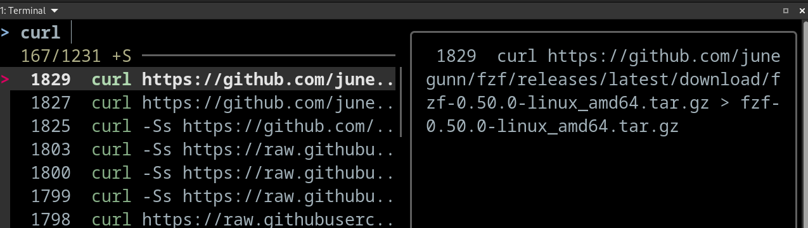
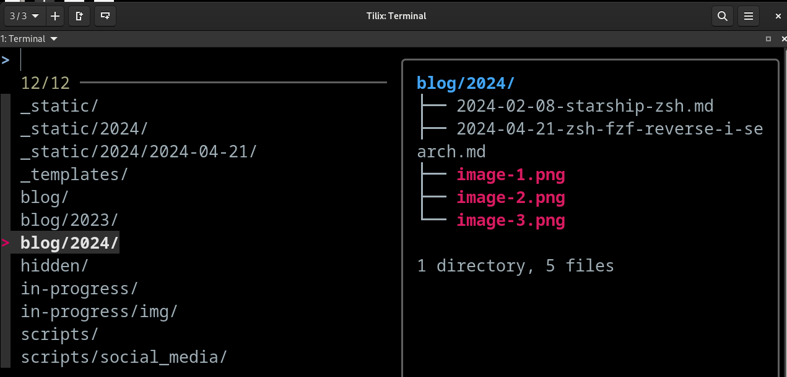
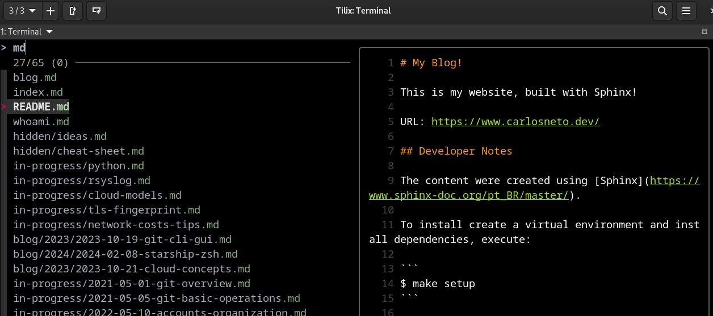
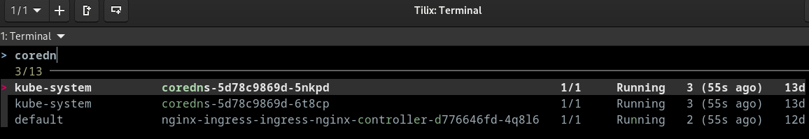

*__Blog Post Publish Date:__ 2024/04/28*

---

# fzf: Life is Too Short for Pipe Grep

This blog post explains why [fzf](https://github.com/junegunn/fzf), a command-line fuzzy finder, replaced `Ctrl` + `R`, `find`, and `command | grep` in my terminal. It also shows how to configure its [Zsh](https://www.zsh.org/) widgets for searching history, files, and directories, with live previews.

## Searching in the Terminal Is Tedious

Searching in the terminal is something you do all the time, and it gets boring fast. Three cases show the problem: searching command history, searching files and directories, and searching command output.

To recall a command, most people press the up and down arrows. Most shells also have an interactive search on `Ctrl` + `R`. In Zsh it's _reverse-i-search_. It works, but you have to press the shortcut again to see each older match, which is painful when you ran the same command many times with different arguments.

To find a file or directory, the usual tool is `$ find`. It works well when you know exactly what you're looking for, but not when you only remember part of the path.

To find something in a command's output, the usual method is `$ command | grep`. It has the same problem as `find`: depending on the case, you run `grep` several times until you find what you need.

That routine pushed me to look for a better way to search interactively.

## Fuzzy Finders Are the Solution

After a few days of research, I found [fzf](https://github.com/junegunn/fzf), a cross-platform fuzzy finder written in Go.

A **fuzzy finder** is a search tool that finds files, directories, or any other items even when you don't remember their exact names. It uses fuzzy matching, so partial words, characters out of order, and typos still find the right result.

fzf filters a list as you type, so you don't need `$ command | grep` anymore. It reads the output of any command for interactive searching. For example, `$ kgp -A | fzf` searches pods across a Kubernetes cluster (`kgp` is the `kubectl get pods` alias from the [kubectl plugin I use in Zsh](/blog/2024/2024-02-08-starship-zsh.md)). fzf also ships shell widgets that search files, directories, and command history.

> <i class="fa-solid fa-circle-info"></i> fzf has widgets for Fish, Bash, and Zsh. You can see them in [github.com/junegunn/fzf/shell](https://github.com/junegunn/fzf/tree/master/shell).

## How to Configure fzf Widgets in Zsh

First, install fzf. The [installation section](https://github.com/junegunn/fzf/tree/master?tab=readme-ov-file#installation) lists several options. Package managers can ship an old version, so I download the latest release from GitHub:

```zsh
setopt INTERACTIVE_COMMENTS

# download the release (at the publish date of this post, the latest version was 0.50.0)
curl -L https://github.com/junegunn/fzf/releases/download/0.50.0/fzf-0.50.0-linux_amd64.tar.gz > fzf-0.50.0-linux_amd64.tar.gz

# uncompress the downloaded file to access the fzf binary
tar -xzvf fzf-0.50.0-linux_amd64.tar.gz

# check fzf binary execution
./fzf --help

# move the binary to a folder present in your path
mv fzf /usr/local/bin/
```

By default, fzf uses `$ find` to list files and directories. You can change that. I use [fd](https://github.com/sharkdp/fd), a faster and friendlier alternative to `find`:

```zsh
# In Linux workstation with dnf package manager
dnf install fd-find

# In MacOs workstation with homebrew package manager
brew install fd
```

For file previews, I use [bat](https://github.com/sharkdp/bat), a `cat` clone with syntax highlighting:

```zsh
# In Linux workstation with dnf package manager
dnf install bat

# In MacOs workstation with homebrew package manager
brew install bat
```

For directory previews, I use [tree](https://www.cyberciti.biz/faq/linux-show-directory-structure-command-line/), which prints the contents of a directory recursively as a tree:

```zsh
# In Linux workstation with dnf package manager
dnf install tree

# In MacOs workstation with homebrew package manager
brew install tree
```

Now load the widgets. Since version 0.48.0, `fzf` prints the setup code for a shell when you pass its name (`--zsh`, `--fish`, or `--bash`):

```zsh
# Set up fzf key bindings and fuzzy completion (only available in 0.48.0 or later)
eval "$(fzf --zsh)"
```

Check that the key bindings were loaded:

```zsh
bindkey -a | grep fzf

# output expected:
#
# "^R" fzf-history-widget  # CTRL + R: reverse history search
# "^T" fzf-file-widget     # CTRL + T: search files
# "^[c" fzf-cd-widget      # ALT  + C: search directories
```

Each widget reads its own [environment variables](https://github.com/junegunn/fzf?tab=readme-ov-file#environment-variables--aliases), so you can tune it to your needs. This is how I configure them:

```zsh
# fzf parameters used in all widgets - configure layout and wrapped the preview results (useful in large command rendering)
export FZF_DEFAULT_OPTS="--height 100% --layout reverse --preview-window=wrap"

# CTRL + R: put the selected history command in the preview window - "{}" will be replaced by item selected in fzf execution runtime
export FZF_CTRL_R_OPTS="--preview 'echo {}'"

# ALT + C: set "fd-find" as directory search engine instead of "find" and exclude "venv|virtualenv|.git" of the results during searching
export FZF_ALT_C_COMMAND="fd --type directory --exclude venv --exclude virtualenv --exclude .git"

# ALT + C: put the tree command output based on item selected
export FZF_ALT_C_OPTS="--preview 'tree -C {}'"

# CTRL + T: set "fd-find" as search engine instead of "find" and exclude "venv|virtualenv|.git" for the results
export FZF_CTRL_T_COMMAND="fd --exclude venv --exclude virtualenv --exclude .git"

# CTRL + T: put the file content if item select is a file, or put tree command output if item selected is directory
export FZF_CTRL_T_OPTS="--preview '[ -d {} ] && tree -C {} || bat --color=always --style=numbers {}'"
```

> My full fzf configuration is in my `~/.zshrc`: <https://github.com/c-neto/ansible-configure-fedora/blob/main/files/dotfiles/.zshrc>

## Results

- _fzf-history-widget_, on `Ctrl` + `R`:



- _fzf-cd-widget_, on `Alt` + `C`:



- _fzf-file-widget_, on `Ctrl` + `T`:



- Searching pods in a Kubernetes cluster with `$ kgp -A | fzf`:



## Why I Recommend fzf

My search for a better command history search gave me much more than I expected. fzf taught me what a fuzzy finder is and what it's for. It isn't limited to history: you can pipe anything into it and search it interactively.

I think it's a much better choice than the default history search in Zsh and Bash. Fish already has a good one, but fzf still adds file and directory search with previews. The search is very fast, and the environment variables let you shape every widget to the way you work. It had more than 59K stars on GitHub when I wrote this post, and I think it earns them. I approve and recommend it!

fzf widgets are regular Zsh widgets bound to keys. If you want to understand how that works, or write your own, I explain it in [Hacking Your Zsh Terminal with Custom Widgets](/blog/2026/2026-10-26-zsh-widgets.md).

## Key Takeaways

- `Ctrl` + `R`, `find`, and `command | grep` all force you to know exactly what you're looking for, or to repeat the search many times.
- A fuzzy finder matches partial words, characters out of order, and typos, and filters the list as you type.
- fzf reads any command's output, so `command | fzf` replaces most `command | grep` searches.
- `eval "$(fzf --zsh)"` (fzf 0.48.0 or later) loads three widgets: `Ctrl` + `R` for history, `Ctrl` + `T` for files, and `Alt` + `C` for directories.
- Use `fd` as the search engine and `bat` and `tree` for previews, configured through the `FZF_*` environment variables.

## References

- [fzf (GitHub)](https://github.com/junegunn/fzf/)
- [fzf shell integrations (GitHub)](https://github.com/junegunn/fzf/tree/master/shell)
- [fd (GitHub)](https://github.com/sharkdp/fd)
- [bat (GitHub)](https://github.com/sharkdp/bat)
- [tree command (nixCraft)](https://www.cyberciti.biz/faq/linux-show-directory-structure-command-line/)
- [Zsh (zsh.org)](https://www.zsh.org/)
- [My fzf configuration in `~/.zshrc` (GitHub)](https://github.com/c-neto/ansible-configure-fedora/tree/main/files/dotfiles/.zshrc)
- Extra: [skim, a fuzzy finder written in Rust (GitHub)](https://github.com/lotabout/skim)

*I'm Carlos Neto, and this blog is where I share my experiences and open source contributions. More about me on [my home page](/index.md). If you have questions or a different approach, contact me on [LinkedIn](https://www.linkedin.com/in/c-neto/).*

---

```{raw} html
<script type="application/ld+json">
{
  "@context": "https://schema.org",
  "@graph": [
    {
      "@type": "BlogPosting",
      "headline": "fzf: Life is Too Short for Pipe Grep",
      "description": "Why fzf replaced Ctrl+R, find, and command | grep in my terminal, and how to set up its Zsh widgets for history, files, and directories with fd, bat, and tree previews.",
      "datePublished": "2024-04-21",
      "inLanguage": "en",
      "url": "https://carlosneto.dev/blog/2024/2024-04-21-fzf/",
      "mainEntityOfPage": "https://carlosneto.dev/blog/2024/2024-04-21-fzf/",
      "image": "https://carlosneto.dev/_static/2024/2024-04-21/results-1.png",
      "keywords": ["fzf", "fuzzy finder", "Zsh", "terminal", "fd", "bat"],
      "author": {"@id": "https://carlosneto.dev/#person"}
    },
    {
      "@type": "Person",
      "@id": "https://carlosneto.dev/#person",
      "name": "Carlos Neto",
      "url": "https://carlosneto.dev/",
      "sameAs": ["https://www.linkedin.com/in/c-neto/", "https://github.com/c-neto"]
    },
    {
      "@type": "BreadcrumbList",
      "itemListElement": [
        {"@type": "ListItem", "position": 1, "name": "Home", "item": "https://carlosneto.dev/"},
        {"@type": "ListItem", "position": 2, "name": "Blog", "item": "https://carlosneto.dev/blog/"},
        {"@type": "ListItem", "position": 3, "name": "fzf: Life is Too Short for Pipe Grep"}
      ]
    }
  ]
}
</script>
```
