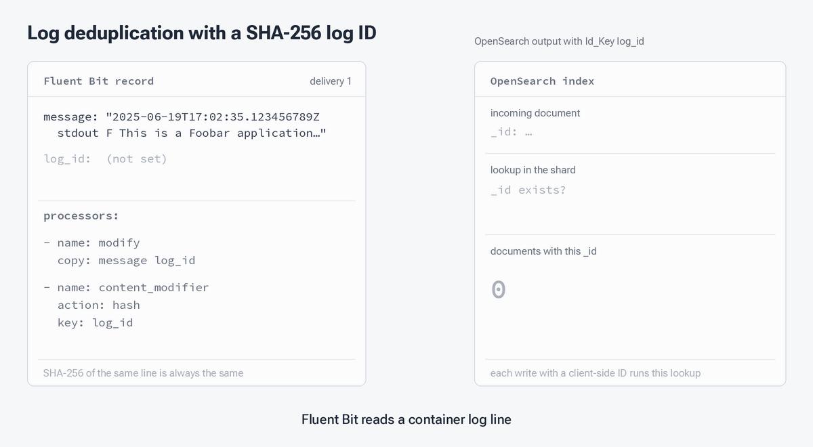

*__Publication Date:__ 2025/06/19*

---

# Fluent Bit: Generating Log IDs with SHA-256 Hashes for Log Deduplication

This blog post explains why Fluent Bit can deliver the same log more than once, and why deduplication needs a unique ID derived from the log content. It then shows how to generate a SHA-256 hash of each log line with only native Fluent Bit features, without external scripts or plugins.

## Why Fluent Bit Delivers Duplicate Logs

I ran into duplicated logs indexed in OpenSearch by Fluent Bit. After some research, I concluded that with the [Tail](https://docs.fluentbit.io/manual/pipeline/inputs/tail) input, Fluent Bit follows an **at-least-once** delivery strategy: a message is delivered one or more times, so duplicates can happen. It does not offer **exactly-once** delivery (each message delivered once) or **at-most-once** delivery (each message delivered once or not at all).

Several things contribute to this. For example, the Tail input can store its state in a database with `DB On`, and you can still get duplicates. The database only stores the read offset of each file, not whether each [output](https://docs.fluentbit.io/manual/pipeline/outputs) received the record.

I plan to write a separate post about how Fluent Bit tracks delivery state (chunks, buffering, SQLite, storage type). For now, the important part is that duplicates can occur in situations such as an unavailable output or a Fluent Bit restart. That is expected behavior, not necessarily a bug, especially with several outputs configured.

## Why You Need a Unique Log ID

With at-least-once delivery, a unique ID is a hard requirement to avoid duplicates at the destination. The ID must be derived from the log content, so the same line always gets the same ID. The destination can then overwrite the duplicate instead of storing a second copy.

If your stack has Logstash or OpenSearch ingest pipelines, the [Logstash fingerprint filter](https://www.elastic.co/docs/reference/logstash/plugins/plugins-filters-fingerprint) and the [OpenSearch fingerprint processor](https://docs.opensearch.org/docs/latest/ingest-pipelines/processors/fingerprint/) both hash selected fields for this. Fluent Bit has no filter dedicated to it. You could use a Lua or shell script callback, but that adds complexity and depends on external crypto libraries. The next section shows a workaround that uses only native Fluent Bit features.

If Fluent Bit sends logs directly to OpenSearch, the [OpenSearch output](https://docs.fluentbit.io/manual/pipeline/outputs/opensearch) has a `Generate_ID On` option. __The ID it generates is not derived from the log line alone__, so the same line read twice, for example after a restart, can get a different ID and still be stored twice. To deduplicate, generate the ID from the log content yourself.

## Generating SHA-256 Hashes with Native Processors

I reviewed the Fluent Bit filters and found none that hash a field. Then I found the [content modifier processor](https://docs.fluentbit.io/manual/pipeline/processors/content-modifier) and its [`hash`](https://docs.fluentbit.io/manual/pipeline/processors/content-modifier#hash-example) action. A **processor** is a step attached directly to an input or output in the YAML configuration. The `hash` action takes a record key and replaces its value with its SHA-256 hash. It's meant for masking sensitive data such as passwords and PII, but it also works for building log IDs.

The __key idea__ is to copy the log line to a new key and hash that copy. The original log line stays intact, and the hashed field becomes the log ID. For example:

```{code-block} yaml
:caption: [/fluent-bit/fluent-bit.yaml](https://github.com/c-neto/my-devops-labs/blob/main/blog/2025-06-19/fluent-bit.yaml)

# The `pipeline.inputs.processors` feature is only available when using the `yaml` configuration format.  
# It is not supported in the legacy `.conf` configuration format.

pipeline:
  inputs:
    - name: dummy
      dummy: |
        {
          "message": "2025-06-19T17:02:35.123456789Z stdout F This is a Foobar application log sample running in kubernetes persisted on /var/log/containers/*.log"
        }
      tag: dummy.foobar
      processors:
        logs:
          # Copy the 'message' field to a new field called '_id'.
          - name: modify
            copy: message _id

          # Hash the '_id' field to anonymize or deduplicate.
          - name: content_modifier
            action: hash
            key: _id

    - name: dummy
      dummy: |
        {
          "message": "2025-06-19T17:02:35.123456789Z stdout F This is a Greeting application log sample running in kubernetes persisted on /var/log/containers/*.log"
        }
      tag: dummy.greeting 
      processors:
        logs:
          # Copy the 'message' field to a new field called '_id'.
          - name: modify
            copy: message _id

          # Hash the '_id' field to anonymize or deduplicate.
          - name: content_modifier
            action: hash
            key: _id

  outputs:
    - name: stdout
      format: json_lines
      match: "dummy.*"

```

The output looks like this. The same line always gets the same `_id`:

```json
{
  "date": 1750366003.411804,
  "message": "2025-06-19T17:02:35.123456789Z stdout F This is a Foobar application log sample running in kubernetes persisted on /var/log/containers/*.log",
  "_id": "19a93f55808eb5478c65813c028045f1b354abe12790eb8aee0dd825697aa93e"
}
{
  "date": 1750366003.415653,
  "message": "2025-06-19T17:02:35.123456789Z stdout F This is a Greeting application log sample running in kubernetes persisted on /var/log/containers/*.log",
  "_id": "148917c2efe0114da7f7cef6327bde63f5c9ec5cac5cf05d4a73acefaa69a55c"
}
{
  "date": 1750366004.412541,
  "message": "2025-06-19T17:02:35.123456789Z stdout F This is a Foobar application log sample running in kubernetes persisted on /var/log/containers/*.log",
  "_id": "19a93f55808eb5478c65813c028045f1b354abe12790eb8aee0dd825697aa93e"
}
{
  "date": 1750366004.413101,
  "message": "2025-06-19T17:02:35.123456789Z stdout F This is a Greeting application log sample running in kubernetes persisted on /var/log/containers/*.log",
  "_id": "148917c2efe0114da7f7cef6327bde63f5c9ec5cac5cf05d4a73acefaa69a55c"
}
```

The `hash` action takes the bytes of the log line, applies SHA-256, and writes the result as a hexadecimal string. This Python snippet produces the same hash as Fluent Bit:

```python
import hashlib

log_line_in_string = "2025-06-19T17:02:35.123456789Z stdout F This is a Foobar application log sample running in kubernetes persisted on /var/log/containers/*.log"

log_line_in_bytes = log_line_in_string.encode("utf-8")
log_line_in_sha256_hexa_decimal = hashlib.sha256(log_line_in_bytes).hexdigest()

print(log_line_in_sha256_hexa_decimal)
>>> "19a93f55808eb5478c65813c028045f1b354abe12790eb8aee0dd825697aa93e"
```

## Using the Hash as the Document ID

Identical log lines always produce the same hash, so the destination can detect the duplicate. Because the raw container log line includes a nanosecond timestamp, two different events almost never share the same content.

To use the hash as the document ID in OpenSearch, point the OpenSearch output's [`Id_Key`](https://docs.fluentbit.io/manual/pipeline/outputs/opensearch) option at the hashed field. A retried or re-read log then overwrites the existing document instead of creating a new one. OpenSearch treats `_id` as a metadata field and rejects it inside the document body, so in a real pipeline give the hashed field another name, such as `log_id`, and set `Id_Key log_id`.



> _A complete, working example of this configuration is in my Docker Compose lab: <i class="fab fa-github"></i> [github.com/c-neto/my-devops-labs/blog/2025-06-19](https://github.com/c-neto/my-devops-labs/blob/main/blog/2025-06-19/)_

The Tail input in these examples reads the container log files that Kubernetes writes under `/var/log/containers/`. I explain how those files are created and rotated in [Kubernetes Logs Simplified](/blog/2025/2025-06-22-kubernetes-logs-simplified.md). Processors can also turn logs into metrics during ingestion, as I show in [Stop Extracting Metrics from OpenSearch Logs](/blog/2026/2026-11-03-stop-extracting-metrics-from-opensearch-logs.md).

## The Cost of Client-Side IDs in OpenSearch

Use this approach with caution. When OpenSearch generates the document ID, it knows that no other document has it, so it writes the document without any lookup. When the client sends the ID, OpenSearch first has to check whether a document with that ID already exists in the shard, so it can overwrite it instead of storing a second copy. That lookup runs on every write. OpenSearch was forked from Elasticsearch, and the [Elasticsearch documentation](https://www.elastic.co/docs/deploy-manage/production-guidance/optimize-performance/indexing-speed#_use_auto_generated_ids) calls the check a costly operation that gets more costly as the index grows. It recommends auto-generated IDs so the engine can skip it.

I applied the deduplication from this post to a cluster that ingested around 50K to 100K logs per second. Each of those logs added a lookup on its shard, and at that rate the extra reads overloaded the cluster. The cluster became extremely slow, and query times rose noticeably.

To work around it, I stopped deduplicating every index. I kept the client-side IDs only on a few specific indices where duplicated logs created noise for the users, and turned deduplication off on the less critical indices, where an occasional duplicate is acceptable.

## Key Takeaways

- With the Tail input, Fluent Bit delivers at least once, so duplicates are expected after output failures or restarts.
- `DB On` stores file offsets, not per-output delivery status, so it doesn't prevent duplicates.
- Deduplication needs an ID derived from the log content. `Generate_ID On` isn't derived from the log line alone.
- Copy the log line to a new key with `modify`, then hash it with the `content_modifier` processor's `hash` action to get a SHA-256 ID.
- Processors on inputs are only available in the YAML configuration format.
- Use the hashed field as the OpenSearch document ID with `Id_Key`, and don't name it `_id`, because OpenSearch rejects that field in the document body.
- A client-side ID makes OpenSearch check the shard for an existing document on every write, a cost that grows with the index. On high-volume clusters, deduplicate only the indices where duplicates hurt users.

## References

- [Content modifier processor: hash (Fluent Bit)](https://docs.fluentbit.io/manual/pipeline/processors/content-modifier#hash-example)
- [Tail input (Fluent Bit)](https://docs.fluentbit.io/manual/pipeline/inputs/tail)
- [OpenSearch output (Fluent Bit)](https://docs.fluentbit.io/manual/pipeline/outputs/opensearch)
- [Fingerprint filter plugin (Logstash)](https://www.elastic.co/docs/reference/logstash/plugins/plugins-filters-fingerprint)
- [Fingerprint processor (OpenSearch)](https://docs.opensearch.org/docs/latest/ingest-pipelines/processors/fingerprint/)
- [Tune for indexing speed: Use auto-generated ids (Elasticsearch)](https://www.elastic.co/docs/deploy-manage/production-guidance/optimize-performance/indexing-speed#_use_auto_generated_ids)
- [Docker Compose lab for this post (GitHub)](https://github.com/c-neto/my-devops-labs/blob/main/blog/2025-06-19/docker-compose.yml)

---

> *I'm Carlos Neto, and I've been running OpenSearch on EKS for over five years. More about me on [my home page](/index.md). If you have questions or a different approach, contact me on [LinkedIn](https://www.linkedin.com/in/c-neto/).*

---

```{raw} html
<script type="application/ld+json">
{
  "@context": "https://schema.org",
  "@graph": [
    {
      "@type": "BlogPosting",
      "headline": "Fluent Bit: Generating Log IDs with SHA-256 Hashes for Log Deduplication",
      "description": "Why Fluent Bit can deliver the same log more than once, why deduplication needs an ID derived from the log content, and how to build a SHA-256 log ID with only native Fluent Bit processors.",
      "datePublished": "2025-06-19",
      "inLanguage": "en",
      "url": "https://carlosneto.dev/blog/2025/2025-06-19-fluentbit-log-dedup/",
      "mainEntityOfPage": "https://carlosneto.dev/blog/2025/2025-06-19-fluentbit-log-dedup/",
      "image": "https://carlosneto.dev/_static/2025/2025-06-19/fluentbit-log-dedup.gif",
      "keywords": ["Fluent Bit", "log deduplication", "SHA-256", "OpenSearch", "at-least-once delivery"],
      "author": {"@id": "https://carlosneto.dev/#person"}
    },
    {
      "@type": "Person",
      "@id": "https://carlosneto.dev/#person",
      "name": "Carlos Neto",
      "url": "https://carlosneto.dev/",
      "sameAs": ["https://www.linkedin.com/in/c-neto/", "https://github.com/c-neto"]
    },
    {
      "@type": "BreadcrumbList",
      "itemListElement": [
        {"@type": "ListItem", "position": 1, "name": "Home", "item": "https://carlosneto.dev/"},
        {"@type": "ListItem", "position": 2, "name": "Blog", "item": "https://carlosneto.dev/blog/"},
        {"@type": "ListItem", "position": 3, "name": "Fluent Bit: Generating Log IDs with SHA-256 Hashes for Log Deduplication"}
      ]
    }
  ]
}
</script>
```
