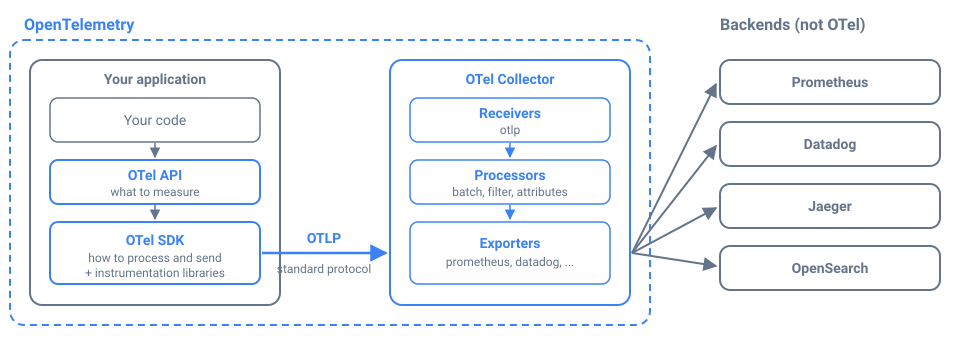

*__Blog Post Publish Date:__ 2026/10/29*

---

# OpenTelemetry: A Framework for Decoupling Your Observability

This blog post explains what OpenTelemetry is and what it's for, without the abstract definitions. It covers the problem it solves, why it shines in microservice architectures, the complexity it brings, and when a simpler setup, such as plain Prometheus, is the better choice.

## Why OpenTelemetry Is Hard to Understand at First

When I started studying OpenTelemetry, I struggled to understand what it actually was. The [official definition](https://opentelemetry.io/docs/what-is-opentelemetry/) calls it _"an open-source, vendor-neutral observability framework"_. It's accurate, but it didn't help me. I kept asking: _Is it a library I add to my code? A service I run? Something like Prometheus?_

The answer is "a bit of each, and not a backend". What finally made it click for me was looking at the problem first.

## The Problem: Every Vendor Has Its Own Everything

Before OpenTelemetry, observing an application meant picking a vendor, and the vendor came with its own library for your code, its own agent to collect the data, and its own format to send it.

Imagine fifty services instrumented with the Datadog library, and the company decides to move to another tool. Every service has to be changed, tested, and redeployed, because the vendor is written into the code. That is vendor lock-in, and it's the main problem OpenTelemetry removes.

## What OpenTelemetry Is

**OpenTelemetry** is an open standard, with official tools, for producing and moving telemetry data: metrics, traces, and logs. People often call it OTel. It covers everything between your code and the backend, but not the backend itself. Storage and dashboards stay with whatever tool you choose.



In plain terms, it has three parts:

- **In your application**: an API that your code calls to say _what_ to measure, and an SDK that decides _how_ to process and send it. Your code depends only on the API, so it never mentions a vendor.
- **On the wire**: **OTLP** is the OpenTelemetry Protocol, one standard format for all telemetry, which most observability vendors accept.
- **In your infrastructure, optionally**: the **Collector** is a service that receives the data and forwards it to one or more backends.

The Collector is not required. The SDK can send OTLP straight to any backend that accepts it, and changing that backend means changing the SDK's exporter configuration, usually an environment variable, not your code. The Collector earns its place when you want one place, outside your services, to decide where the data goes and what happens to it on the way.

A comparison that helps developers: JDBC in Java, or the DB-API in Python. Your code talks to one standard interface, and the database behind it can be swapped. OpenTelemetry does the same for telemetry.

## Where OpenTelemetry Shines: Microservices

OpenTelemetry pays off most in microservice architectures, where many services, written in different languages by different teams, work together on the same request.

A payment request might cross an API in Python, a fraud check in Java, and a gateway in Go. With OpenTelemetry, all of them instrument the same way, use the same attribute names, and pass the same request context to each other, so one trace follows the request across every service. When something fails, you can go from a latency spike on a dashboard to the exact request and the service that slowed it down, because metrics, traces, and logs can share that context: logs emitted through OpenTelemetry carry the trace ID, and metrics can point to sample traces.

That's also where the Collector pays off, as the one place to apply rules for every service: remove sensitive data, drop noisy telemetry to control cost, add Kubernetes metadata, or send the same data to two backends during a migration.

## The Cost: OpenTelemetry Is Not Simple

All of that comes with complexity. There are new concepts to learn (API, SDK, exporters, resources, context propagation), SDKs to configure in every service, and, once you adopt it, a Collector to deploy, scale, and monitor. The specification is large, and some parts are newer than others in some languages. It also takes agreement between teams: instrumentation only pays off when every service follows the same conventions.

For a large system, that cost is small next to what you gain. For a small one, it can be more machinery than the problem needs.

## When You Don't Need OpenTelemetry

**Small and simple systems.** If you run a monolith or a handful of services, in one language, with one backend you don't plan to change, a Prometheus client library and a Prometheus server already solve the problem. The application exposes `/metrics`, Prometheus scrapes it, and you're done. Add OpenTelemetry when the system grows into the problems it solves, not before.

**Software you didn't write.** OpenTelemetry instrumentation is for your own applications, the business services where only your team knows which events matter, such as payments processed or orders failed. Off-the-shelf services such as Logstash, PostgreSQL, Redis, NGINX, or OpenSearch already expose their own metrics, through a monitoring API or a Prometheus exporter. That's where plain Prometheus shines: scrape what the tool already provides, and don't try to instrument it yourself. If you already run the Collector, its `prometheus` receiver can scrape those same endpoints, so they still don't need any OpenTelemetry instrumentation.

## My Take

OpenTelemetry isn't something to adopt everywhere by default. It's the right tool when you have many business services, several teams, and a real need to follow requests across them or to keep your options open on vendors. In that scenario, the separation it brings is what I value most: the application team says what to measure, and the platform team decides where the data goes, without either waiting on the other.

## Key Takeaways

- OpenTelemetry is an open standard plus tools for producing and moving telemetry. It is not a backend.
- Your code depends only on its API and data travels over OTLP, so changing vendors means changing configuration, not code.
- The Collector is optional. The SDK can export straight to a backend; add the Collector when you need central routing and processing.
- It shines in microservices: many services, languages, and teams sharing one way to instrument and one trace per request.
- It adds real complexity: new concepts, SDK configuration in every service, and possibly a Collector to operate.
- For small, simple systems, a Prometheus client and a Prometheus server are enough.
- Use it for your own business services. For off-the-shelf software such as Logstash or PostgreSQL, scrape the metrics they already expose with Prometheus.

## References

- [What is OpenTelemetry? (OpenTelemetry)](https://opentelemetry.io/docs/what-is-opentelemetry/)
- [OpenTelemetry concepts: components (OpenTelemetry)](https://opentelemetry.io/docs/concepts/components/)
- [OpenTelemetry Collector (OpenTelemetry)](https://opentelemetry.io/docs/collector/)
- [Context propagation (OpenTelemetry)](https://opentelemetry.io/docs/concepts/context-propagation/)
- [Instrumentation and exporters (Prometheus)](https://prometheus.io/docs/instrumenting/exporters/)
- [OpenTelemetry project page (CNCF)](https://www.cncf.io/projects/opentelemetry/)
---
> 
---

> *I'm Carlos Neto, and this blog is where I share my experiences and open source contributions. More about me on [my home page](/index.md). If you have questions or a different approach, contact me on [LinkedIn](https://www.linkedin.com/in/c-neto/).*

---

```{raw} html
<script type="application/ld+json">
{
  "@context": "https://schema.org",
  "@graph": [
    {
      "@type": "BlogPosting",
      "headline": "OpenTelemetry: A Framework for Decoupling Your Observability",
      "description": "What OpenTelemetry is and what it's for, in plain terms: the vendor lock-in it removes, why it shines in microservices, the complexity it adds, and when plain Prometheus is the better choice.",
      "datePublished": "2026-10-29",
      "inLanguage": "en",
      "url": "https://carlosneto.dev/blog/2026/2026-10-29-otel-foundation/",
      "mainEntityOfPage": "https://carlosneto.dev/blog/2026/2026-10-29-otel-foundation/",
      "image": "https://carlosneto.dev/_static/2026/2026-10-29/opentelemetry-pieces.svg",
      "keywords": ["OpenTelemetry", "observability", "microservices", "vendor lock-in", "Prometheus"],
      "author": {"@id": "https://carlosneto.dev/#person"}
    },
    {
      "@type": "Person",
      "@id": "https://carlosneto.dev/#person",
      "name": "Carlos Neto",
      "url": "https://carlosneto.dev/",
      "sameAs": ["https://www.linkedin.com/in/c-neto/", "https://github.com/c-neto"]
    },
    {
      "@type": "BreadcrumbList",
      "itemListElement": [
        {"@type": "ListItem", "position": 1, "name": "Home", "item": "https://carlosneto.dev/"},
        {"@type": "ListItem", "position": 2, "name": "Blog", "item": "https://carlosneto.dev/blog/"},
        {"@type": "ListItem", "position": 3, "name": "OpenTelemetry: A Framework for Decoupling Your Observability"}
      ]
    }
  ]
}
</script>
```
