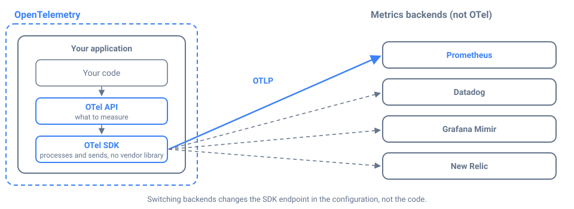
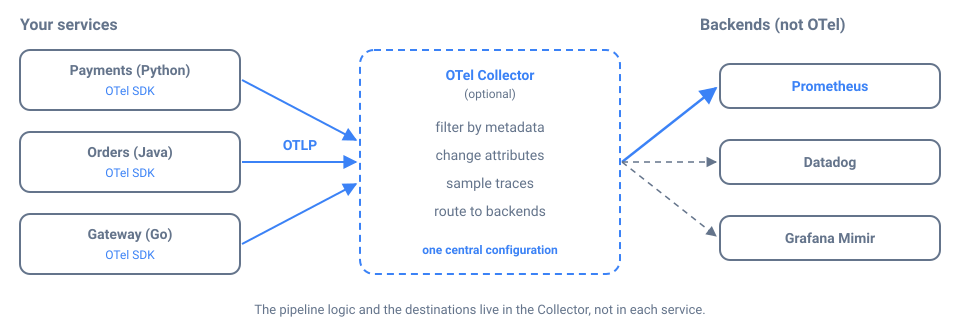

*__Blog Post Publish Date:__ 2026/10/29*

---

# OpenTelemetry: A Framework for Decoupling Your Observability

This post is my take on what OpenTelemetry is and the problem it solves, explained directly and in my own words.

## Not Another Tool, Just a Standard

OpenTelemetry is an observability framework that standardizes how telemetry is instrumented and collected, so you don't depend on the tools and formats of a specific vendor and can integrate with different backends, such as Prometheus, Jaeger, Grafana Mimir, and Datadog.

OpenTelemetry doesn't store data, draw dashboards, or fire alerts, and those jobs stay with the tools you already use. It defines the rules for how data leaves your application and reaches those tools, so any of them can sit on the other end.

## More Than an Interface

In the source code, OpenTelemetry defines the interfaces your application calls to produce telemetry, and that alone removes much of the vendor lock-in. Your code depends on the OpenTelemetry API instead of a vendor library, so changing vendors means changing what sits behind that API, usually just the SDK configuration, while the code stays the same. SQLAlchemy works the same way in Python. Your code talks to SQLAlchemy, and moving from PostgreSQL to MySQL means changing the driver and the connection settings, not the queries. OpenTelemetry goes further, because a common interface alone doesn't make observability standard. It also defines how the data is named and how it travels.

The first standard is how the code produces data. Your application calls the OpenTelemetry API to record a request or count a payment, with the same concepts whether it's written in Python, Java, or Go. Behind that API, the SDK is the engine that decides what to do with the data. Often you don't even write those calls, since there are [ready-made instrumentations](https://opentelemetry.io/docs/concepts/instrumentation/libraries/) for frameworks like FastAPI and Spring Boot, and [agents that instrument an application at runtime](https://opentelemetry.io/docs/zero-code/) without touching its code.

The second is how the data is named. OpenTelemetry has [naming conventions](https://opentelemetry.io/docs/concepts/semantic-conventions/) for common information, so an HTTP request, a database call, or the name of a service is described the same way in every application. A query or a dashboard built for one team's service works for another team's service too, as long as both follow the same version of the conventions.

The third is how the data travels. [OTLP](https://opentelemetry.io/docs/specs/otlp/) is the protocol OpenTelemetry defines for sending telemetry, and Prometheus, Jaeger, Datadog, and most other tools know how to receive it, each one for the signals it handles, such as metrics in Prometheus and traces in Jaeger. Some of them, like Prometheus, need the [OTLP receiver turned on](https://prometheus.io/docs/guides/opentelemetry/) first. The application doesn't need to speak each tool's language, only OTLP.

The [KodeKloud OTCA course](https://notes.kodekloud.com/docs/Prep-Course-OpenTelemetry-Certified-Associate-OTCA-Certification/OpenTelemetry-Core-Concepts/Standards-and-Specification/page) compares this to USB. Before a common connector, every device needed its own cable, and OpenTelemetry is that common connector for observability data.

## Change the Destination, Not the Code

Without OpenTelemetry, each service carries the library of a specific vendor. If fifty services are instrumented with the Datadog library and the company decides to move to another tool, all fifty have to be changed, tested, and deployed again. That's vendor lock-in, and that cost alone can keep a team on a tool it no longer wants.

With OpenTelemetry, the code only speaks the standard, and where the data goes is configuration. Pointing to another tool means changing the address, the credentials, and sometimes a few settings the new tool expects, all in environment variables or a configuration file, and the application code stays the same.



In larger setups, that configuration usually lives in the [OpenTelemetry Collector](https://opentelemetry.io/docs/collector/), an optional service that sits between the applications and the tools. Every application sends its data to the Collector, and the Collector decides what to filter, what to change, and where to forward it. Changing tools, or sending the same data to two of them during a migration, becomes a change in one file.



I show this in practice in [A Hands-On Example of Decoupling App Instrumentation with OpenTelemetry](/blog/2026/2026-11-18-otel-python-instrumentation.md). A Python service sends its metrics to Prometheus and then to Datadog, and the only thing that changes between the two is the Collector configuration.

## When It's Worth the Trouble

OpenTelemetry pays off when there are many services, written in different languages and owned by different teams, or when the same data has to reach more than one tool. It also doesn't force you to throw away what already works. A log pipeline built on Fluent Bit or Logstash, such as a [Fluent Bit DaemonSet collecting Kubernetes logs](/blog/2025/2025-06-22-kubernetes-logs-simplified.md), can keep running, and Fluent Bit itself [can receive and send OTLP](https://docs.fluentbit.io/manual/data-pipeline/outputs/opentelemetry).

That comes at a cost. There are new concepts to learn, each service needs its SDK or agent configured, and a Collector, if you use one, is one more service to deploy, scale, and monitor.

## Key Takeaways

- OpenTelemetry standardizes how applications produce, name, and send telemetry, and it doesn't store, display, or alert on data.
- The standard goes beyond an interface for the code. It includes naming conventions and OTLP, the protocol that carries the data.
- Prometheus, Jaeger, Datadog, and most observability tools can receive OTLP, each for the signals it handles.
- With the code speaking the standard, changing tools means changing configuration, not the source code.
- The Collector is optional and keeps that configuration in one place, which turns a migration into a change in one file.
- The benefits grow with the number of services, languages, teams, and tools, and so does the operational cost.

## References

- [What is OpenTelemetry? (OpenTelemetry)](https://opentelemetry.io/docs/what-is-opentelemetry/)
- [Components (OpenTelemetry)](https://opentelemetry.io/docs/concepts/components/)
- [Semantic Conventions (OpenTelemetry)](https://opentelemetry.io/docs/concepts/semantic-conventions/)
- [OTLP Specification (OpenTelemetry)](https://opentelemetry.io/docs/specs/otlp/)
- [Instrumentation libraries (OpenTelemetry)](https://opentelemetry.io/docs/concepts/instrumentation/libraries/)
- [Zero-code instrumentation (OpenTelemetry)](https://opentelemetry.io/docs/zero-code/)
- [OpenTelemetry Collector (OpenTelemetry)](https://opentelemetry.io/docs/collector/)
- [Using Prometheus as your OpenTelemetry backend (Prometheus)](https://prometheus.io/docs/guides/opentelemetry/)
- [OpenTelemetry output plugin (Fluent Bit)](https://docs.fluentbit.io/manual/data-pipeline/outputs/opentelemetry)
- [Standards and Specification (KodeKloud)](https://notes.kodekloud.com/docs/Prep-Course-OpenTelemetry-Certified-Associate-OTCA-Certification/OpenTelemetry-Core-Concepts/Standards-and-Specification/page)
- [OpenTelemetry Certified Associate prep course (KodeKloud)](https://notes.kodekloud.com/docs/Prep-Course-OpenTelemetry-Certified-Associate-OTCA-Certification/index)

---

> *I'm Carlos Neto, and this blog is where I share my experiences and open source contributions. More about me on [my home page](/index.md). If you have questions or a different approach, contact me on [LinkedIn](https://www.linkedin.com/in/c-neto/).*

---

```{raw} html
<script type="application/ld+json">
{
  "@context": "https://schema.org",
  "@graph": [
    {
      "@type": "BlogPosting",
      "headline": "OpenTelemetry: A Framework for Decoupling Your Observability",
      "description": "What OpenTelemetry is and the problem it solves, without the jargon. It standardizes how applications produce, name, and send telemetry, so you can change tools without changing code.",
      "datePublished": "2026-10-29",
      "inLanguage": "en",
      "url": "https://carlosneto.dev/blog/2026/2026-10-29-otel-foundation/",
      "mainEntityOfPage": "https://carlosneto.dev/blog/2026/2026-10-29-otel-foundation/",
      "image": "https://carlosneto.dev/_static/2026/2026-10-29/opentelemetry-pieces.svg",
      "keywords": ["OpenTelemetry", "OTLP", "vendor lock-in", "semantic conventions", "OpenTelemetry Collector"],
      "author": {"@id": "https://carlosneto.dev/#person"}
    },
    {
      "@type": "Person",
      "@id": "https://carlosneto.dev/#person",
      "name": "Carlos Neto",
      "url": "https://carlosneto.dev/",
      "sameAs": ["https://www.linkedin.com/in/c-neto/", "https://github.com/c-neto"]
    },
    {
      "@type": "BreadcrumbList",
      "itemListElement": [
        {"@type": "ListItem", "position": 1, "name": "Home", "item": "https://carlosneto.dev/"},
        {"@type": "ListItem", "position": 2, "name": "Blog", "item": "https://carlosneto.dev/blog/"},
        {"@type": "ListItem", "position": 3, "name": "OpenTelemetry: A Framework for Decoupling Your Observability"}
      ]
    }
  ]
}
</script>
```
