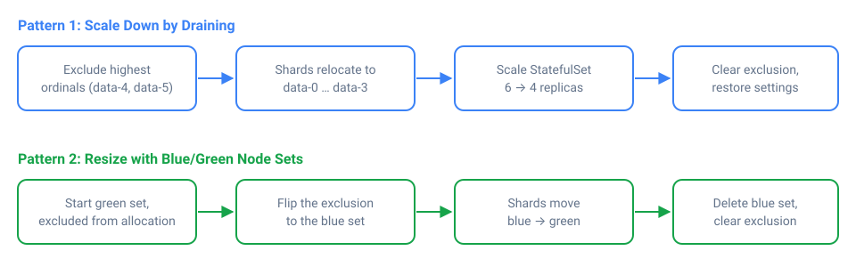

*__Blog Post Publish Date:__ 2026/11/10*

---

# Scaling Down and Resizing OpenSearch Data Nodes Without Losing Data

This blog post covers the patterns and API calls I use to scale down and resize OpenSearch data nodes without losing data. The rule behind all of them is simple: the data on a node you remove has to end up somewhere else first. If you take nodes away faster than the cluster can relocate their shards, you lose data.

## Why Removing Nodes Is Risky

Scaling down or resizing the data tier is one of the riskiest operations you can perform on an OpenSearch cluster. That is true whether you are shrinking the fleet to cut cost, moving to a different instance type, or replacing nodes that use ephemeral storage. Every time I do it, I treat it that way, and I have never regretted being slow about it.

OpenSearch distributes data as shards across nodes (see [OpenSearch Concepts - Index and Shards](/blog/2025/2025-01-05-opensearch-concepts-index-and-shards.md)). When a node disappears abruptly, the cluster has to rebuild the missing shard copies from the ones that survive, which consumes bandwidth, CPU, and I/O. If several nodes go at once, or replica counts are too low, the last copy of a shard can disappear before recovery completes.

Scaling up only adds capacity. Scaling down removes capacity that currently holds data, so every node you take out must have its shards relocated to the survivors before it goes. A resize is a scale-down and a scale-up chained together: you replace a node, or a whole node group, with a different shape, and the same rule applies.

A few concepts come up in every step:

- **Allocation** is how OpenSearch decides which node holds each shard. It happens automatically, and you can influence it through the [Cluster Settings API](https://docs.opensearch.org/latest/api-reference/cluster-api/cluster-settings/).
- **Rebalancing** is the background process that moves shards between nodes to keep an even distribution. During a scale-down or resize, you want to pause it to avoid unnecessary shard movement.
- **Draining** is using an allocation exclusion to tell OpenSearch to move every shard off a specific node before you remove it. It works for any kind of storage, including Instance Store, because once a node is empty, losing its disk does not matter.
- **Blue/Green** is bringing up a parallel set of nodes in the new shape, migrating all data to them, then decommissioning the old set. This is how you resize nodes whose disks do not survive replacement.

The safe path is always the same: control shard allocation explicitly, verify the cluster state before each step, and only then remove nodes.

### Use Persistent Settings

All the examples below use `persistent` cluster settings. [Transient settings are cleared after a full cluster restart](https://docs.opensearch.org/latest/api-reference/cluster-api/cluster-settings/). If the cluster restarts in the middle of a migration, a transient allocation exclusion silently disappears and OpenSearch starts placing shards on the nodes you were draining. Persistent settings stay until you remove them, which also means you must remember to clear them at the end.

## What to Watch During a Migration

Monitoring is essential during shard migrations, especially when increasing recovery concurrency or bandwidth limits. I use the following APIs to track shard relocation progress, identify allocation issues, and watch resource consumption across the cluster:

| What it shows | API call |
|---|---|
| All shards, sorted by state | `GET /_cat/shards?v&s=state` |
| Shards grouped by index | `GET /_cat/shards?v&s=index` |
| Shards grouped by node | `GET /_cat/shards?v&s=node` |
| Compact view: index, shard, primary/replica, state, node | `GET /_cat/shards?v&h=index,shard,prirep,state,node&s=index` |
| Ongoing recoveries with details | `GET /_cat/recovery?active_only=true&detailed=true&bytes=gb&v` |
| Recovery history, including completed ones | `GET /_cat/recovery?v` |
| Overall cluster health | `GET /_cluster/health` |
| Wait for relocations and initializations to finish | `GET /_cluster/health?wait_for_no_relocating_shards=true&wait_for_no_initializing_shards=true` |
| Pending cluster tasks | `GET /_cat/pending_tasks?v` |
| Active cluster tasks | `GET /_cat/tasks?v` |
| Why a shard is unassigned or cannot be allocated | `GET /_cluster/allocation/explain` |
| Node list and resource information | `GET /_cat/nodes?v&s=name` |
| Disk usage and shard count per node | `GET /_cat/allocation?v` |
| Filesystem and JVM statistics | `GET /_nodes/stats/fs,jvm` |
| Operating system and thread pool statistics | `GET /_nodes/stats/os,thread_pool` |
| Network transport statistics | `GET /_nodes/stats/transport` |

The [Cluster Allocation Explain API](https://docs.opensearch.org/latest/api-reference/cluster-api/cluster-allocation/) can also investigate a specific shard:

```{code-block} json
:caption: POST /_cluster/allocation/explain
{
  "index": "my-index",
  "shard": 0,
  "primary": true
}
```

Pay particular attention to filesystem utilization and JVM memory pressure. When increasing recovery concurrency, also monitor network throughput at the infrastructure level, since the OpenSearch transport statistics alone do not give a complete picture of network bandwidth. If nodes start approaching resource limits, reduce recovery concurrency and bandwidth before the migration affects normal cluster operations.

Keep these commands at hand throughout the migration and check them before removing each node. A migration is only complete when the intended nodes are empty, shard recoveries have finished, and the cluster is healthy again.

## Speeding Up Shard Relocation

OpenSearch applies conservative limits to shard recovery and relocation so these operations do not consume too many cluster resources. By default, a node allows [two concurrent incoming and two concurrent outgoing shard recoveries](https://docs.opensearch.org/latest/install-and-configure/configuring-opensearch/cluster-settings/), and the recovery transfer rate is limited to `40mb` per second per node. These limits keep the cluster stable during shard movements, but they can also make large migrations take much longer than necessary.

Shards moved off an excluded node are relocations, so they are throttled by these recovery limits, not by the rebalancing settings. If your cluster has spare CPU, memory, disk I/O, and network capacity, you can raise them:

```{code-block} json
:caption: PUT /_cluster/settings
{
  "persistent": {
    "cluster.routing.allocation.node_concurrent_recoveries": 10,
    "indices.recovery.max_bytes_per_sec": "200mb"
  }
}
```

Be careful when increasing these values. More concurrent recoveries and higher transfer rates put significant pressure on data nodes. If the infrastructure cannot handle the additional work, the nodes become overloaded, normal cluster operations suffer, and the entire cluster can become unresponsive.

<!-- [PERSONAL EXPERIENCE] -->
I've experienced this firsthand: increasing recovery concurrency too aggressively overloaded the nodes and brought the cluster to a point where it stopped responding properly. Network saturation is another risk, especially when relocating large amounts of data between nodes.

Treat these values as temporary tuning, not recommended defaults. Increase them gradually, watch node and network utilization, and reduce them if the cluster shows signs of saturation. Once the migration is complete, restore the defaults by setting them to `null`:

```{code-block} json
:caption: PUT /_cluster/settings
{
  "persistent": {
    "cluster.routing.allocation.node_concurrent_recoveries": null,
    "indices.recovery.max_bytes_per_sec": null
  }
}
```

## Which Downsize Pattern to Use

The right approach depends on the operation and on whether the disk survives the node:

| Operation | Network-attached storage (EBS) | Instance Store |
|---|---|---|
| Remove nodes (scale down) | Pattern 1: drain, then remove | Pattern 1: drain, then remove |
| Change the instance type (resize) | Rolling replacement that reattaches the volume, or Pattern 2 | Pattern 2: Blue/Green |

---



## Pattern 1: Scale Down by Draining

Use this when you want fewer data nodes. It works for both network-attached storage (EBS, NFS) and ephemeral storage (Instance Store), because the node is empty before it is terminated.

Both patterns assume dedicated data nodes. If the nodes you are removing are also cluster-manager-eligible, removing several of them at once can break the cluster-manager quorum, so take them out of the voting configuration first.

### Step 1: Check Capacity

Before draining, make sure the remaining nodes have enough free disk to absorb the shards you are about to relocate and still stay under the disk watermarks. Removing nodes puts the same data on fewer machines. If the remaining nodes fill past `cluster.routing.allocation.disk.watermark.high`, allocation stalls and you get stuck mid-scale-down. I explain how watermarks drive allocation in [OpenSearch Shard Allocation: Balanced by Count, Rebalanced by Watermarks](/blog/2026/2026-11-04-opensearch-watermark.md).

Use `GET /_cat/allocation?v` to compare the disk used on the nodes you are removing with the free disk on the nodes that stay.

### Step 2: Disable Shard Rebalancing

Tell OpenSearch to stop moving shards around for balance:

```{code-block} json
:caption: PUT /_cluster/settings
{
  "persistent": {
    "cluster.routing.rebalance.enable": "none"
  }
}
```

This prevents background rebalancing from competing with the drain and wasting I/O and bandwidth on movements you are about to undo. Disabling rebalancing does not stop OpenSearch from moving shards off excluded nodes, so the drain in the next step still works.

### Step 3: Drain the Nodes You Are Removing

Exclude the nodes from shard allocation before terminating them:

```{code-block} json
:caption: PUT /_cluster/settings
{
  "persistent": {
    "cluster.routing.allocation.exclude._name": "opensearch-data-4, opensearch-data-5"
  }
}
```

On Kubernetes, a StatefulSet scale-down always removes the pods with the [highest ordinals](https://kubernetes.io/docs/concepts/workloads/controllers/statefulset/). Going from six replicas to four removes `opensearch-data-5` and `opensearch-data-4`, so those are the nodes to exclude.

OpenSearch now moves all primary and replica shards off the excluded nodes. Monitor progress with:

```bash
# look for `RELOCATING` or `UNASSIGNED` shards.
GET _cat/shards?v&s=state

# verify the excluded nodes are draining.
GET _cat/shards?v&s=node

# watch the recovery and relocation tasks.
GET _cat/tasks

# wait for green.
GET _cluster/health
```

Wait until the excluded nodes have zero shards assigned and the cluster is green before proceeding.

### Step 4: Remove the Drained Nodes

Once the nodes are empty, remove them, for example by scaling the StatefulSet down, and confirm the cluster is still green afterward.

With EBS, scaling down does not delete the PersistentVolumeClaims of the removed pods by default. Their volumes keep costing money, and they reattach with stale data the next time you scale up. Delete them, or set the StatefulSet's [`persistentVolumeClaimRetentionPolicy`](https://kubernetes.io/docs/concepts/workloads/controllers/statefulset/#persistentvolumeclaim-retention) so Kubernetes removes them on scale-down.

### Step 5: Clear the Exclusion and Re-enable Rebalancing

Remove the exclusion and restore rebalancing:

```{code-block} json
:caption: PUT /_cluster/settings
{
  "persistent": {
    "cluster.routing.allocation.exclude._name": null,
    "cluster.routing.rebalance.enable": null
  }
}
```

<!-- [UNIQUE INSIGHT] -->
Do not skip the exclusion cleanup. StatefulSets reuse pod names, so the next time you scale up, a new `opensearch-data-4` would join the cluster still excluded and never receive shards. If you raised the recovery limits, restore them as well.

## Pattern 2: Resize with Blue/Green Node Sets

Use this when you need to replace the nodes themselves, not just remove some of them. The typical case is changing the instance type of nodes whose disks do not survive replacement, such as NVMe SSDs on EC2 Instance Store. You cannot resize these nodes in place, because the new instance starts with an empty disk. The data has to move to the new node set before the old one goes away.

With network-attached storage the trade-off is different. On Kubernetes, an EBS-backed StatefulSet pod can move to a node with a different instance type and its volume reattaches. A rolling replacement then only has to recover the writes that happened while the pod was down. EBS volumes are bound to one Availability Zone, so the new node must run in the same zone as the volume. Blue/Green still works for EBS, but it copies the entire dataset.

The idea: run two StatefulSets in parallel (`blue` and `green`), migrate shards from one to the other, then decommission the old set. If you run the hot tier on Instance Store, the readiness probe and Karpenter settings from [OpenSearch + EC2 Instance Store](/blog/2026/2026-11-08-opensearch-hot-instance-store.md) apply to both StatefulSets during this process.

### Step 1: Disable Shard Rebalancing

Same as Pattern 1, prevent automatic redistribution while you are in control:

```{code-block} json
:caption: PUT /_cluster/settings
{
  "persistent": {
    "cluster.routing.rebalance.enable": "none"
  }
}
```

### Step 2: Bring Up the New Node Set (Green) Without Data

Exclude the new nodes from shard allocation before they start, so they can boot and join the cluster without triggering a flood of shard movement. New indices, such as the next rollover, would otherwise be allocated to them right away:

```{code-block} json
:caption: PUT /_cluster/settings
{
  "persistent": {
    "cluster.routing.allocation.exclude._name": "green-node-1, green-node-2, green-node-N"
  }
}
```

Deploy the new node set and wait for all nodes to reach `Ready` status. The green nodes need the same node attributes as the blue ones, for example the attribute that marks them as hot tier. If your indices use `index.routing.allocation.require.*` filters and the green nodes lack the matching attribute, the shards have nowhere to go and the migration stalls.

### Step 3: Migrate Data from Blue to Green

Now flip the exclusion to the old (blue) nodes. OpenSearch begins moving shards off the blue nodes and onto the green nodes:

```{code-block} json
:caption: PUT /_cluster/settings
{
  "persistent": {
    "cluster.routing.allocation.exclude._name": "blue-node-1, blue-node-2, blue-node-N"
  }
}
```

Monitor the migration closely:

```bash
# look for `RELOCATING` or `UNASSIGNED` shards.
GET _cat/shards?v&s=state

# verify the blue nodes are draining.
GET _cat/shards?v&s=node

# watch the recovery and relocation tasks.
GET _cat/tasks

# wait for green.
GET _cluster/health
```

Do not proceed until all shards have moved off the blue nodes and cluster health is green.

### Step 4: Decommission the Old Node Set

Once all data is on the green nodes, delete the old (blue) StatefulSet:

```bash
kubectl delete sts <blue-statefulset-name>
```

This terminates every blue pod at once. That is safe for empty data-only nodes, but see the cluster-manager note in Pattern 1 if the blue nodes have other roles.

### Step 5: Clean Up Exclusions and Restore Settings

Remove the exclusion rules so future shard assignments work normally, restore rebalancing, and reset the recovery limits if you raised them:

```{code-block} json
:caption: PUT /_cluster/settings
{
  "persistent": {
    "cluster.routing.allocation.exclude._name": null,
    "cluster.routing.rebalance.enable": null,
    "cluster.routing.allocation.node_concurrent_recoveries": null,
    "indices.recovery.max_bytes_per_sec": null
  }
}
```

## Key Takeaways

- Scaling down is riskier than scaling up because existing data must be relocated before nodes are removed.
- Draining with `exclude._name` works for any storage type. Once a node is empty, losing its disk does not matter.
- Resizing nodes on ephemeral storage requires Blue/Green. On EBS-backed StatefulSets, a rolling replacement that reattaches volumes is usually cheaper.
- Disable shard rebalancing during planned migrations. It does not block the relocation of shards off excluded nodes.
- Use persistent settings so a cluster restart does not silently drop your exclusions, and clear them afterward. StatefulSets reuse pod names, so a leftover exclusion will catch the next node with the same name.
- Always verify shard allocation, cluster health, and available disk capacity before moving to the next step.

## References

- [Cluster Settings API (OpenSearch)](https://docs.opensearch.org/latest/api-reference/cluster-api/cluster-settings/)
- [Cluster settings reference (OpenSearch)](https://docs.opensearch.org/latest/install-and-configure/configuring-opensearch/cluster-settings/)
- [Cluster Allocation Explain API (OpenSearch)](https://docs.opensearch.org/latest/api-reference/cluster-api/cluster-allocation/)
- [Availability and recovery (OpenSearch)](https://docs.opensearch.org/latest/tuning-your-cluster/availability-and-recovery/)
- [CAT shards (OpenSearch)](https://docs.opensearch.org/latest/api-reference/cat/cat-shards/)
- [StatefulSets (Kubernetes)](https://kubernetes.io/docs/concepts/workloads/controllers/statefulset/)

*I'm Carlos Neto, and I've been running OpenSearch on EKS for over five years. More about me on [my home page](/index.md). If you have questions or a different approach, contact me on [LinkedIn](https://www.linkedin.com/in/c-neto/).*

```{raw} html
<script type="application/ld+json">
{
  "@context": "https://schema.org",
  "@graph": [
    {
      "@type": "BlogPosting",
      "headline": "Scaling Down and Resizing OpenSearch Data Nodes Without Losing Data",
      "description": "How to drain, scale down, and resize OpenSearch data nodes on Kubernetes without losing data, including Blue/Green migrations for EC2 Instance Store.",
      "datePublished": "2026-11-10",
      "inLanguage": "en",
      "url": "https://carlosneto.dev/blog/2026/2026-11-10-opensearch-scale-down/",
      "mainEntityOfPage": "https://carlosneto.dev/blog/2026/2026-11-10-opensearch-scale-down/",
      "image": "https://carlosneto.dev/_static/2026/2026-11-10/opensearch-scale-down-patterns.svg",
      "keywords": ["OpenSearch", "Kubernetes", "StatefulSet", "shard allocation", "Blue/Green"],
      "author": {"@id": "https://carlosneto.dev/#person"}
    },
    {
      "@type": "Person",
      "@id": "https://carlosneto.dev/#person",
      "name": "Carlos Neto",
      "url": "https://carlosneto.dev/",
      "sameAs": ["https://www.linkedin.com/in/c-neto/", "https://github.com/c-neto"]
    },
    {
      "@type": "BreadcrumbList",
      "itemListElement": [
        {"@type": "ListItem", "position": 1, "name": "Home", "item": "https://carlosneto.dev/"},
        {"@type": "ListItem", "position": 2, "name": "Blog", "item": "https://carlosneto.dev/blog/"},
        {"@type": "ListItem", "position": 3, "name": "Scaling Down and Resizing OpenSearch Data Nodes Without Losing Data"}
      ]
    }
  ]
}
</script>
```
