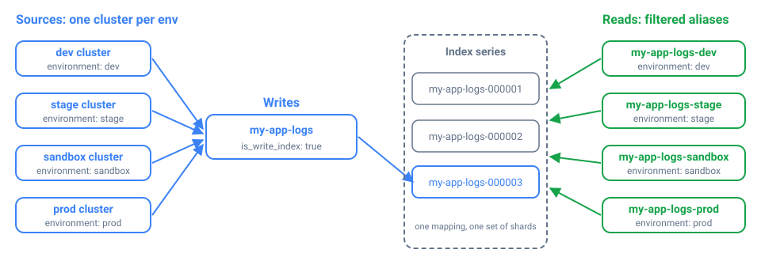

*__Blog Post Publish Date:__ 2026/11/11*

---

# Avoiding Over-Sharding in OpenSearch with Filtered Aliases per Environment

This blog post covers one of the strategies I use to avoid over-sharding in OpenSearch. Instead of per-environment indexes, I write all logs into one index series and expose each environment as a filtered alias. The rule behind it is simple: the environment is an attribute of each document, so it belongs in a field, not in the index name. The cluster keeps fewer, fuller shards and one mapping, and OpenSearch Dashboards users still get a per-environment view that behaves like a dedicated index.

## Too Many Small Shards: The Problem With Per-Environment Indexes

The instinct is to give every environment its own index, and I used to do exactly that:

```bash
my-app-logs-dev
my-app-logs-stage
my-app-logs-sandbox
my-app-logs-prod
...
```

It looks tidy, but it scales badly. Every index has a footprint, even an empty one. Each [shard](/blog/2025/2025-01-05-opensearch-concepts-index-and-shards.md) is a Lucene index. It uses heap and file handles and takes up space in the cluster state. A `dev` environment that gets a trickle of logs still gets the shard count your template sets, so a 50 MB index can end up split into several half-empty shards. Multiply that by every environment and every log type, and the cluster carries hundreds of nearly empty shards for no benefit. That is over-sharding.

Small shards also cause the problem I described in my post about [shard allocation and disk watermarks](/blog/2026/2026-11-04-opensearch-watermark.md). The default allocator balances shards by count, not by size. In a cluster with many small, granular indexes, one node can hold dozens of tiny shards and use very little disk, while another holds a few large shards and is almost full. The shard distribution looks balanced, but disk usage tells a different story, and the disk watermarks end up doing the balancing work. Per-environment indexes are an easy way to end up there, so they are one of the first things I avoid when I design index templates.

Splitting the data also makes it harder to query. To look at all environments, or a subset of them, someone has to know which indexes exist and target them with wildcards or comma-separated lists.

The data has the same shape in every environment: the same application's logs, coming from a different cluster. That makes the environment an attribute of each record, so I model it as a field. It looks like a minor decision, but it saves a lot of operational work later.

## How Filtered Aliases Split One Index by Environment

A **filtered alias** is an alias with a query filter attached. According to the [OpenSearch documentation](https://docs.opensearch.org/latest/im-plugin/index-alias/), the filter applies to every search, count, and delete-by-query call that goes through the alias. For example, `my-app-logs-prod` points at the `my-app-logs` indexes with a filter of `environment: prod`. A query on `my-app-logs-prod` returns only production documents, even though all environments share the same indexes.



An alias doesn't copy data or add shards. The cluster holds one index series and a handful of alias definitions.

## Defining the Aliases in an Index Template

An **index template** is a set of settings, mappings, and aliases that OpenSearch applies to every new index whose name matches its pattern. The aliases belong in the [index template](https://docs.opensearch.org/latest/im-plugin/index-templates/), not in a one-off `_aliases` call. An alias added through the API attaches only to the indexes that exist at that moment, even with a wildcard pattern. Indexes created later are not added. With the aliases in the template, every new index in the series carries them from the start:

```opensearch
PUT _index_template/my-app-logs
{
  "index_patterns": ["my-app-logs*"],
  "template": {
    "settings": {
      "index.number_of_shards": "4",
      "index.number_of_replicas": "1",
      "index.refresh_interval": "10s",
      "index.routing.allocation.require.temp": "hot",
      "plugins.index_state_management.rollover_alias": "my-app-logs"
    },
    "aliases": {
      "my-app-logs-dev": {
        "is_write_index": false,
        "filter": { "term": { "environment": "dev" } }
      },
      "my-app-logs-stage": {
        "is_write_index": false,
        "filter": { "term": { "environment": "stage" } }
      },
      "my-app-logs-sandbox": {
        "is_write_index": false,
        "filter": { "term": { "environment": "sandbox" } }
      },
      "my-app-logs-prod": {
        "is_write_index": false,
        "filter": { "term": { "environment": "prod" } }
      }
    }
  },
  "composed_of": [
    "settings-default",
    "default-mappings",
    "kubernetes-mappings",
    "my-app-logs-mappings"
  ]
}
```

Each environment alias pairs `is_write_index: false` with a `term` filter. The aliases are read-only views, and nothing writes through them. [`term`](https://docs.opensearch.org/latest/query-dsl/term/term/) is an exact-match query, so `my-app-logs-prod` resolves to the documents whose `environment` is exactly `prod`. For that to work, `environment` must be mapped as a `keyword` field in one of the component templates. On an analyzed `text` field, a `term` filter can silently miss documents.

The shared settings and mappings come from the component templates listed in `composed_of`. Because every environment writes into the same indexes, they all get the same field mappings. Two environments can no longer drift apart, which is a common problem when each one has its own index.

Writes go through a single rollover alias, `my-app-logs`. A **rollover alias** is the alias that ISM moves to a new index each time the current one gets too big or too old. Here it is set in `plugins.index_state_management.rollover_alias` and managed by an [ISM policy](https://docs.opensearch.org/latest/im-plugin/ism/policies/). Create the first index with that alias as the write index, as you would for any rollover setup:

```opensearch
PUT my-app-logs-000001
{
  "aliases": {
    "my-app-logs": {
      "is_write_index": true
    }
  }
}
```

The log shipper in each environment's cluster writes to `my-app-logs` and sets the `environment` field from the cluster it runs in. ISM rolls the series over by size or age (`my-app-logs-000001`, `my-app-logs-000002`, ...). Because the environment aliases live in the template, each new index starts with all of them attached.

## Per-Environment Views in OpenSearch Dashboards

The people reading the logs benefit the most from this pattern. In Dashboards, create one index pattern per environment alias. `my-app-logs-prod` shows only production logs, and `my-app-logs-stage` shows only staging. An index pattern of `my-app-logs*` shows every environment in one place.

To an analyst, `my-app-logs-prod` looks and behaves like a dedicated production index, with the same fields and search experience, scoped to production. They don't need to know it is a filtered view. Cross-environment questions such as "show me this error in stage and production" are easy to answer because the data was never split up.

## Per-Environment Indexes vs. Filtered Aliases

| Concern | Per-environment indexes | Unified index + filtered aliases |
| --- | --- | --- |
| Shard and cluster-state footprint | One or more shards per environment, even tiny ones | One index's shards, shared by all environments |
| Small environments | Under-filled shards wasting heap and disk | No dedicated footprint, just an alias |
| Cross-environment queries | Wildcards or comma lists across many indexes | One index series, optionally filtered |
| Per-environment view | Natural | Preserved through the filtered alias |
| Mapping consistency | Can drift between environments | One shared mapping |
| Rollover and ISM | One rollover series per environment | One rollover series |

## When to Use Separate Indexes Anyway

A filtered alias is a read convenience over shared storage. When environments need real physical separation, use separate indexes:

- __Hard isolation and access control__. If production and dev must live on different storage tiers, or a user must never be able to touch production shards, an alias filter is not a security boundary. Anyone allowed to read the underlying indexes can query them directly and skip the filter. If you only need to restrict which documents a role can read, the Security plugin's [document-level security](https://docs.opensearch.org/latest/security/access-control/document-level-security/) does that on a shared index.
- __Very different retention or sizing__. Say production needs 180 days of retention on large shards and dev needs 2 days on small ones. Separate index series with their own ISM policies are cleaner than one policy for everything.
- __Very different volume__. If one environment produces far more data than the others and needs a different shard layout, splitting it out can be justified.

The common case is the same log type coming from several environments with similar retention and mappings. For that, I use this pattern almost by default: one index series, one mapping, one rollover alias, and as many per-environment views as you need.

## Key Takeaways

- Model the environment as a field. Every environment's logs have the same shape, so they belong in the same index series.
- One index per environment multiplies under-filled shards, and each one costs heap, file handles, and cluster state even when it holds almost no data.
- Fewer, fuller shards keep count-based shard balancing closer to real disk usage, so the disk watermarks have less to correct.
- A filtered alias doesn't copy data. Searches, counts, and delete-by-query through the alias only see documents that match its filter.
- Define the environment aliases in the index template. Aliases added with the `_aliases` API do not attach to indexes that rollover creates later.
- Map `environment` as a `keyword` field so the `term` filter matches exactly.
- Write through a single rollover alias managed by ISM, and keep the environment aliases read-only with `is_write_index: false`.
- An alias filter is not a security boundary. Use document-level security to restrict reads, and separate indexes when an environment needs physical isolation, different retention, or a different shard layout.

## References

- [Index aliases (OpenSearch)](https://docs.opensearch.org/latest/im-plugin/index-alias/)
- [Index templates (OpenSearch)](https://docs.opensearch.org/latest/im-plugin/index-templates/)
- [Term query (OpenSearch)](https://docs.opensearch.org/latest/query-dsl/term/term/)
- [ISM policies (OpenSearch)](https://docs.opensearch.org/latest/im-plugin/ism/policies/)
- [Document-level security (OpenSearch)](https://docs.opensearch.org/latest/security/access-control/document-level-security/)

*I'm Carlos Neto, and I've been running OpenSearch on EKS for over five years. More about me on [my home page](/index.md). If you have questions or a different approach, contact me on [LinkedIn](https://www.linkedin.com/in/c-neto/).*

---

```{raw} html
<script type="application/ld+json">
{
  "@context": "https://schema.org",
  "@graph": [
    {
      "@type": "BlogPosting",
      "headline": "Avoiding Over-Sharding in OpenSearch with Filtered Aliases per Environment",
      "description": "Store logs from every environment in one OpenSearch index series and expose each environment as a filtered alias defined in the index template, instead of creating one index per environment.",
      "datePublished": "2026-11-11",
      "inLanguage": "en",
      "url": "https://carlosneto.dev/blog/2026/2026-11-11-opensearch-alias-filtered-by-field/",
      "mainEntityOfPage": "https://carlosneto.dev/blog/2026/2026-11-11-opensearch-alias-filtered-by-field/",
      "image": "https://carlosneto.dev/_static/2026/2026-11-11/opensearch-filtered-aliases.svg",
      "keywords": ["OpenSearch", "index alias", "filtered alias", "index template", "ISM"],
      "author": {"@id": "https://carlosneto.dev/#person"}
    },
    {
      "@type": "Person",
      "@id": "https://carlosneto.dev/#person",
      "name": "Carlos Neto",
      "url": "https://carlosneto.dev/",
      "sameAs": ["https://www.linkedin.com/in/c-neto/", "https://github.com/c-neto"]
    },
    {
      "@type": "BreadcrumbList",
      "itemListElement": [
        {"@type": "ListItem", "position": 1, "name": "Home", "item": "https://carlosneto.dev/"},
        {"@type": "ListItem", "position": 2, "name": "Blog", "item": "https://carlosneto.dev/blog/"},
        {"@type": "ListItem", "position": 3, "name": "Avoiding Over-Sharding in OpenSearch with Filtered Aliases per Environment"}
      ]
    }
  ]
}
</script>
```
