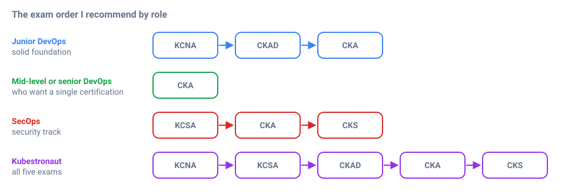

*__Blog Post Publish Date:__ 2026/11/15*

---

# Kubestronaut: My Honest Journey (Including Procrastination and a Retake)

This post is an honest account of how I passed the five CNCF Kubernetes certifications (CKA, KCNA, KCSA, CKAD, and CKS) and became a Kubestronaut. I share how I overcame a year of procrastination, why I failed the CKS even though I was prepared for it, the study routine and methods that worked for me, what each exam asks for, and the order I recommend for your professional profile.

__DISCLAIMER:__ Everything in this post comes from my own experience, in my context and my life. Don't take it as an absolute recommendation. I'm not trying to say what is "right", only to share what I went through. What worked for me might not work for you.

## Why I Wanted the Certifications

I started the Kubestronaut path as a senior DevOps engineer, after more than five years of working with Kubernetes every day. The title didn't change much in my career. At my level, market experience still counts more than a certificate. What I wanted was a reason to study the parts of Kubernetes I never touched at work, and the exam curriculum gave me a study roadmap for them.

The title also comes with some perks. According to the Kubestronaut Program page, a Kubestronaut gets an exclusive jacket, a [Credly badge](https://training.linuxfoundation.org/resources/kubestronaut-program/), and access to a private Slack channel and mailing list. Every year, you also get five 50%-off certification coupons, which you can use yourself or share, and 20% off three [CNCF events](https://www.cncf.io/events/), such as [KubeCon](https://www.cncf.io/kubecon-cloudnativecon-events/) or KubeDays.

Knowing a subject is different from mastering it. Knowing means you understand which tools exist to solve a problem. Mastering means you have the practical experience to pick the solution closest to ideal for a given context, and that only comes with time and real work. A certification says you know Kubernetes. It doesn't say you master it.

From what I've seen and talked about with colleagues, the market uses these certifications mostly to speed up interviews and to strengthen your position when negotiating a contract. They signal that you know the Kubernetes basics. Before you start, ask yourself honestly why you want one and what you'll do with it, because the certificate alone won't change your life. What you learn on the way is worth more than the badge.

People often tell me the exams are expensive, and they are, especially if you don't earn in dollars. Still, the fee is the cheap part. The hours of study and the mental energy they drain cost much more.

## What Each Exam Covers

The five exams fall into two groups. KCNA and KCSA are multiple-choice exams, and you can't consult anything. CKA, CKAD, and CKS are hands-on: you solve tasks in a terminal on a remote Linux desktop, with access to a list of official documentation sites.

| Exam | Format | Duration | Documentation allowed |
| --- | --- | --- | --- |
| [KCNA](https://training.linuxfoundation.org/certification/kubernetes-cloud-native-associate/) | Multiple choice | 90 minutes | None |
| [KCSA](https://training.linuxfoundation.org/certification/kubernetes-and-cloud-native-security-associate-kcsa/) | Multiple choice | 90 minutes | None |
| [CKAD](https://training.linuxfoundation.org/certification/certified-kubernetes-application-developer-ckad/) | 15 to 20 hands-on tasks | 2 hours | kubernetes.io, Helm |
| [CKA](https://training.linuxfoundation.org/certification/certified-kubernetes-administrator-cka/) | 15 to 20 hands-on tasks | 2 hours | kubernetes.io, Helm, Gateway API |
| [CKS](https://training.linuxfoundation.org/certification/certified-kubernetes-security-specialist/) | 15 to 20 hands-on tasks | 2 hours | kubernetes.io, Falco, etcd, Cilium, Istio, and others |

The format and duration come from each exam page, the [CKA and CKAD tips](https://docs.linuxfoundation.org/tc-docs/certification/tips-cka-and-ckad), and the [CKS instructions](https://docs.linuxfoundation.org/tc-docs/certification/important-instructions-cks). The documentation list comes from the [Resources Allowed page](https://docs.linuxfoundation.org/tc-docs/certification/certification-resources-allowed). The passing score is 66% for the CKA and CKAD and 67% for the CKS, according to the [Linux Foundation FAQ](https://docs.linuxfoundation.org/tc-docs/certification/faq-cka-ckad-cks).

**KCNA (_Kubernetes and Cloud Native Associate_):** is for people starting with Kubernetes. It asks conceptual questions like "what is a Pod?", "what is a container?", "which component decides on which node a Pod runs?", or "what is the difference between a Deployment and a StatefulSet?". If you already work with Kubernetes, even at a junior level, you'll pass it with your eyes closed.

**KCSA (_Kubernetes and Cloud Native Security Associate_):** follows the same idea, but with security concepts. For a SecOps engineer it's easy. For me it wasn't, and I don't think a mid-level or senior DevOps engineer should underestimate it. It asks things my SecOps colleagues know by heart, such as what an SBOM is or which Trivy flag does a specific thing. Expect questions like which Pod Security Standard blocks privileged containers, what an attacker could do with direct access to etcd, or what the 4Cs of cloud native security are. Gaps like this one are why I wanted the Kubestronaut path in the first place.

**CKAD (_Certified Kubernetes Application Developer_):** is where it gets interesting, and it's the simplest of the hands-on exams. It covers using a cluster: scaling a Deployment, rolling back, reading logs, analyzing errors. A typical task asks you to create a Deployment and expose it with a Service, add a liveness probe to a Pod, mount a ConfigMap or a Secret into a container, schedule a CronJob, add a sidecar container, or install a chart with Helm. The name is misleading. You don't need to program anything, at most a trivial Bash script that prints something. Python, Go, or Java knowledge is useless here. "Application Developer" describes someone who gets a working cluster and needs to deploy an application to it, not someone who writes Kubernetes Operators or controllers. You may need to use a CRD or an Operator, but never write one.

**CKA (_Certified Kubernetes Administrator_):** is denser. It covers everything in the CKAD plus cluster provisioning and operation: configuring the kubelet, diagnosing a node that can't join the cluster, reading systemd logs, and upgrading a cluster. You may also need to fix a broken control plane component, find out why a Pod is stuck in `Pending`, give a user access to a namespace with a Role and a RoleBinding, expose an application through the Gateway API, or create a PersistentVolumeClaim from a StorageClass. Troubleshooting is the biggest part of the exam.

**CKS (_Certified Kubernetes Security Specialist_):** is the exam I have the most reservations about. It isn't hard, but it covers the most topics and tools, none of them very deep. Besides Kubernetes security itself, such as NetworkPolicies, Roles, and ClusterRoles, it asks you to use security tools to verify image signatures, check container image dependencies, and run Docker without root. Other examples are writing a NetworkPolicy that denies all traffic by default, applying an AppArmor or seccomp profile to a Pod, enforcing a Pod Security Standard in a namespace, scanning images for vulnerabilities, finding a suspicious process with Falco, or enabling audit logs on the API server. My reservation is the prerequisite: you must pass the CKA before taking the CKS. In my exam, one task was to upgrade the cluster. The curriculum lists it under cluster hardening, as a way to avoid known vulnerabilities, and I understand the reasoning. Still, upgrading a cluster felt much closer to the CKA than to a security exam. I think this overlap makes the path harder for people who want a security track, and the KCSA would be a more sensible prerequisite.

These are only examples to give you an idea. The full list of topics for each exam is in the [CNCF curriculum repository](https://github.com/cncf/curriculum).

Because the hands-on exams let you open the official documentation, don't try to memorize everything. Learn to do the tasks using the docs as a guide, and remember where each piece of information lives. Not every tool is on the list, though: Trivy, for example, isn't, so practice its flags before the CKS.

## The Order I Took Them, and the One I Recommend

I took them in a poorly planned order: CKA, KCNA, KCSA, CKAD, and then CKS. There was no logic behind it, and that is one of the reasons I wrote this post. If I were starting again, I'd pick a path based on my role:



A junior DevOps engineer gets a solid foundation going from the KCNA to the CKAD and then the CKA. If you're a mid-level or senior DevOps engineer and want only one, take the CKA. If you're in SecOps, start with the KCSA, then the CKA (unfortunately, because of the CKS prerequisite), then the CKS. And for the Kubestronaut title, go from the easiest to the hardest: KCNA, KCSA, CKAD, CKA, and CKS.

If you're not sure which certification to take, don't buy the Kubestronaut bundle first. Buy one exam. That's what I did. Buying the bundle up front creates a bigger commitment than you need.

Also check the current requirements before planning the full path. The Linux Foundation [announced](https://training.linuxfoundation.org/resources/kubestronaut-program/) that starting February 15, 2027, the Certified Kubernetes Network Engineer (CKNE) will also be required for Kubestronaut status.

I also disagree with the idea that these certifications are only for people who already master Kubernetes. They suit people who are learning it even better. If I knew nothing about Kubernetes today, I would study for the certifications instead of watching random YouTube videos. The curriculum makes the learning curve much less tortuous.

## A Year of Procrastination, Then Six Months of Focus

Before the six months in which I passed everything, I procrastinated for a whole year. I would start studying, stop, come back weeks later, and remember nothing. Every restart, I had forgotten the imperative kubectl commands and had to learn them again.

What changed was the gym. I have trouble with focus, and starting a regular exercise routine trained the discipline I then used to study. I only managed to finish the certifications because I started going to the gym at the same time. Running, walking, or any regular sport should work the same way.

The routine that worked for me was one hour a day. Not two, not three. A five-hour rush on Sunday doesn't make you learn. I kept one day a week, usually Sunday, without studying. And I stopped negotiating with myself: "I won't study today, but tomorrow I'll do two hours" is the beginning of failure.

Two more habits helped. I didn't keep checking the course progress bar, because that only triggered anxiety. And I stopped telling people I was studying for a certification. Our brain is dumb: when we announce that we're doing something, it feels like we already did it. There's research behind this. In four experiments published in Psychological Science, Peter Gollwitzer and colleagues found that when other people took notice of an identity-related intention, such as studying law to become a lawyer, participants acted on it less than those whose intention was ignored. Being noticed gave them a premature sense of already having that identity ([Gollwitzer et al., 2009](https://doi.org/10.1111/j.1467-9280.2009.02336.x)). Finish the exam first, then show it off.

Finally, I used a single study source: the [KodeKloud](https://kodekloud.com/) courses. That choice surprised me, because I've always struggled with video courses. I lose focus quickly, so I've always studied from physical books, on paper, away from notifications and from the quick glances at email, WhatsApp, and Instagram that feed you cheap dopamine. Even with that resistance, I loved KodeKloud. I'm not paid to say this, but they are the best courses I've ever taken: a video lesson, then a lab prepared only to practice what the lesson covered, with no distractions. Every lesson also has a full text transcript and translated subtitles. Every topic in the course is worth studying, especially the ones that aren't on the exam, such as TLS.

When a topic was hard for me to understand, I talked about it with ChatGPT in voice mode until it made sense. Saying the question out loud and going back to the part I still didn't get helped me understand concepts that were difficult for me. It also let me express my frustration with the topic, almost like venting.

## How I Prepared for the Hands-On Exams

Don't overestimate yourself. If you're an experienced DevOps engineer who knows Kubernetes well and thinks you'll pass easily, be careful. In the exam there's no Google, no AI, and no IDE you're used to. Maybe you don't need to study Kubernetes, but you definitely need to study for the exam. Knowing how to do everything isn't enough. You need to do everything fast, in Vim, in a laggy remote terminal, with the clock in your head. The exam has no trick questions. It's well designed and reasonably difficult, but it requires solid preparation, and you can't pass it after studying for a weekend.

The labs mattered more than the videos. For the final preparation, I redid all the KodeKloud mock exams until I got everything right, no matter how many times it took. Then I did the two [Killer Shell](https://killer.sh/) simulator sessions until I got them right too. Each session is only available for a limited time after you activate it, so I reserved a weekend for each one. The simulator looks a lot like the real exam environment.

I also used [CK-X](https://github.com/sailor-sh/CK-X), an open source project that runs a Killer Shell-like simulator locally with Docker Compose, for free. It helped me a lot. Practice questions are never too many, so I also used the [CKS exam guide](https://devsecops.puziol.com.br/kubernetes/cks/exam/) and [solved CKS questions](https://devsecops.puziol.com.br/category/cks-quest%C3%B5es-resolvidas/) by David Puziol.

One thing I would skip: a home lab. I bought a mini PC on AliExpress, installed Proxmox, and built base images for my cluster. I spent more time fighting Proxmox and networking than practicing Kubernetes, while the course labs were ready to use.

Drill the imperative kubectl commands until they're automatic, because they generate resources and YAML much faster than writing manifests by hand. Learn Vim too. You only need it to edit YAML, but you need to do that well, and I wrote [Vim for Kubernetes Certification Exams](/blog/2026/2026-07-15-vim-kubernetes-exams.md) about the techniques I used. Finally, prepare your workstation. Keyboard layouts and shortcuts can break you, especially on a MacBook with a Brazilian layout, where a dead key can stop you from typing `~` in `cd ~/Documents`. My checklist is in [Workstation Setup for Kubernetes Exams](/blog/2026/2026-07-09-workstation-setup-kubernetes-exams.md).

## Failing the CKS by One Point

The CKS passing score is [67%](https://docs.linuxfoundation.org/tc-docs/certification/faq-cka-ckad-cks). On my first attempt, I scored 66%.

During the exam, I got stuck on a task to configure Docker to expose the runtime over TCP instead of the Unix socket. I knew how to do the rest of the exam, but I didn't know that one at first, and I kept insisting on it. When I noticed the time, I had about 10 tasks left and less than 60 minutes. If a task is on a topic you don't master, skip it and come back later.

But perfectionism wasn't the only cause. For every exam, I keep a rule: the day before, I don't touch the computer, stay fully offline, and don't study. A hands-on exam needs a rested mind. For the first CKS attempt, I broke that rule. I spent about eight hours on Sunday redoing every lab, and on Monday at 8 AM I was tired and making simple mistakes.

On the second attempt I followed my rule and passed with 81%. My suggestion is to schedule the exam for Monday morning, with Sunday free: sleep a lot, go to the mall, have an ice cream. On a Monday morning, your mind isn't yet filled with work problems.

If you fail, you're not a failure. You get the chance to prepare more and end up knowing more than someone who passed by luck. Failing would be giving up or going back to procrastinating.

## Was It Worth It?

I really enjoyed the Kubestronaut journey. It cost me a lot of energy and some sacrifices in my personal life, but it was an enriching experience. Besides learning topics I don't use at work, it made me a more resilient person. Some topics are fun and some are very boring, and you have to accept both. If you're still thinking about it, buy the exam and do it.

## Key Takeaways

- A certification shows that you know Kubernetes, not that you master it. Mastery comes from time and real work.
- The main cost is your study time and mental energy, not the exam fee. Know why you want the certification before you start.
- Buy one exam first, not the bundle, and choose the order by your role. I took them in an unplanned order: CKA, KCNA, KCSA, CKAD, CKS.
- One hour a day with one day off worked for me after a year of start-and-stop procrastination. Regular exercise gave me the focus to keep it.
- Use one study source, prioritize labs over videos, and practice under exam conditions: imperative kubectl, Vim, and the official docs.
- Skip the home lab. I lost more time on Proxmox and networking than on Kubernetes.
- Rest the day before the exam. I failed the CKS with 66% after an eight-hour study rush the day before, and passed with 81% when I rested.

## References

- [Kubestronaut Program (Linux Foundation)](https://training.linuxfoundation.org/resources/kubestronaut-program/)
- [Frequently Asked Questions: CKA, CKAD, and CKS (Linux Foundation)](https://docs.linuxfoundation.org/tc-docs/certification/faq-cka-ckad-cks)
- [Important Tips: CKA and CKAD (Linux Foundation)](https://docs.linuxfoundation.org/tc-docs/certification/tips-cka-and-ckad)
- [Important Instructions: CKS (Linux Foundation)](https://docs.linuxfoundation.org/tc-docs/certification/important-instructions-cks)
- [Certification Resources Allowed (Linux Foundation)](https://docs.linuxfoundation.org/tc-docs/certification/certification-resources-allowed)
- [Kubernetes and Cloud Native Associate (Linux Foundation)](https://training.linuxfoundation.org/certification/kubernetes-cloud-native-associate/)
- [Kubernetes and Cloud Native Security Associate (Linux Foundation)](https://training.linuxfoundation.org/certification/kubernetes-and-cloud-native-security-associate-kcsa/)
- [CK-X Simulator (GitHub)](https://github.com/sailor-sh/CK-X)
- [When Intentions Go Public: Does Social Reality Widen the Intention-Behavior Gap? (Psychological Science, 2009)](https://doi.org/10.1111/j.1467-9280.2009.02336.x)

---

> *I'm Carlos Neto, and this blog is where I share my experiences and open source contributions. More about me on [my home page](/index.md). If you have questions or a different approach, contact me on [LinkedIn](https://www.linkedin.com/in/c-neto/).*

---

```{raw} html
<script type="application/ld+json">
{
  "@context": "https://schema.org",
  "@graph": [
    {
      "@type": "BlogPosting",
      "headline": "Kubestronaut: My Honest Journey (Including Procrastination and a Retake)",
      "description": "How I earned the Kubestronaut title as a senior DevOps engineer: a year of procrastination, six focused months, failing the CKS by one point, and the study routine and exam order I recommend.",
      "datePublished": "2026-11-15",
      "inLanguage": "en",
      "url": "https://carlosneto.dev/blog/2026/2026-11-15-kubestronaut-journey/",
      "mainEntityOfPage": "https://carlosneto.dev/blog/2026/2026-11-15-kubestronaut-journey/",
      "image": "https://carlosneto.dev/_static/2026/2026-11-15/kubestronaut-exam-paths.svg",
      "keywords": ["Kubernetes", "Kubestronaut", "CKA", "CKAD", "CKS", "KCNA", "KCSA", "Kubernetes certification"],
      "author": {"@id": "https://carlosneto.dev/#person"}
    },
    {
      "@type": "Person",
      "@id": "https://carlosneto.dev/#person",
      "name": "Carlos Neto",
      "url": "https://carlosneto.dev/",
      "sameAs": ["https://www.linkedin.com/in/c-neto/", "https://github.com/c-neto"]
    },
    {
      "@type": "BreadcrumbList",
      "itemListElement": [
        {"@type": "ListItem", "position": 1, "name": "Home", "item": "https://carlosneto.dev/"},
        {"@type": "ListItem", "position": 2, "name": "Blog", "item": "https://carlosneto.dev/blog/"},
        {"@type": "ListItem", "position": 3, "name": "Kubestronaut: My Honest Journey (Including Procrastination and a Retake)"}
      ]
    }
  ]
}
</script>
```
