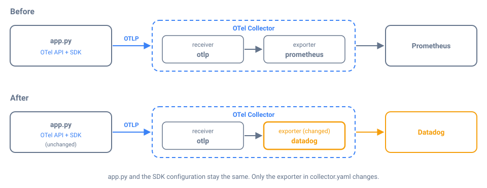

*__Publication Date:__ 2026/11/18*

---

# Vendor Lock-Out: A Hands-On OpenTelemetry Example

This post shows, with a small Python service, how OpenTelemetry keeps you out of vendor lock-in by letting you change where telemetry goes without touching the application code. The service sends its metrics to Prometheus and then to Datadog, and the only file that changes between the two is the Collector configuration.

It's the hands-on companion to [OpenTelemetry: A Framework for Decoupling Your Observability](/blog/2026/2026-10-29-otel-foundation.md), which explains what OpenTelemetry is and the problem it solves. Here the goal is to see that idea working, with as little code as possible.

## The Code Only Knows the API

The example is a payment service that counts how many payments it processes. Its code imports only the OpenTelemetry API, with no SDK and no vendor library.

```{code-block} python
:caption: app.py

import random
import time

from opentelemetry import metrics

meter = metrics.get_meter("payment-api")
payments = meter.create_counter("payments_processed", description="Number of processed payments")

while True:
    if random.random() > 0.1:
        status = "success"
    else:
        status = "failure"
    payments.add(1, {"status": status})
    time.sleep(1)
```

The meter creates instruments, and a **counter** is the simplest of them, a total that only goes up. Each payment adds one to it, with a `status` attribute that separates successes from failures. A counter like this is also far cheaper than counting log lines to get the same number, as I explain in [Stop Extracting Metrics from OpenSearch Logs](/blog/2026/2026-11-03-stop-extracting-metrics-from-opensearch-logs.md).

If you install only the API (`pip install opentelemetry-api`) and run this file, it works and exports nothing. Without an SDK, every API call does nothing, and that's what keeps the code independent. It describes what to measure and leaves the decision about where the data goes to whoever runs it. The same behavior gives you an easy way to turn telemetry off. If you don't want it in a system, you don't install the SDK, and the instrumented code keeps running as if the calls weren't there. If the SDK is already installed, setting [`OTEL_SDK_DISABLED=true`](https://opentelemetry.io/docs/specs/otel/configuration/sdk-environment-variables/) has the same effect.

## The SDK Comes From the Environment

To send the data out, the process needs the SDK. The `opentelemetry-instrument` launcher loads it before the code runs and configures it from environment variables.

```bash
pip install opentelemetry-distro opentelemetry-exporter-otlp

export OTEL_SERVICE_NAME=payment-api
export OTEL_METRICS_EXPORTER=otlp
export OTEL_EXPORTER_OTLP_ENDPOINT=http://localhost:4317
export OTEL_METRIC_EXPORT_INTERVAL=5000
export OTEL_TRACES_EXPORTER=none
export OTEL_LOGS_EXPORTER=none

opentelemetry-instrument python app.py
```

The [variables](https://opentelemetry.io/docs/specs/otel/configuration/sdk-environment-variables/) name the service, send metrics over OTLP to port 4317, and export every five seconds instead of the default minute. The shorter interval makes the demo quicker to check. Traces and logs are off because the example only produces metrics. You can also configure the SDK in code, but I prefer the launcher, because `app.py` stays the same file and all the configuration lives outside it.

The endpoint doesn't name Prometheus or Datadog. It points to a Collector, and that's where the destination is decided. The Collector isn't required, though. Prometheus and Datadog both accept OTLP, so these same variables could send the data straight to either of them, with the endpoint, credentials, and settings each one expects. I use the Collector in this example because it's the most common pattern, and the [OpenTelemetry documentation](https://opentelemetry.io/docs/collector/) recommends it in general, since it takes care of retries, batching, encryption, and filtering of sensitive data. Start the application after the Collector from the next section is running, or the SDK logs connection errors until something answers on that port.

## The Collector Decides Where the Data Goes

A [Collector configuration](https://opentelemetry.io/docs/collector/configuration/) is a pipeline. Receivers define how data comes in, and exporters define where it goes. Neither side has to be the application or a backend. An exporter can publish the metrics to a [Kafka topic](https://github.com/open-telemetry/opentelemetry-collector-contrib/blob/main/exporter/kafkaexporter/README.md), and a second Collector with the [Kafka receiver](https://github.com/open-telemetry/opentelemetry-collector-contrib/blob/main/receiver/kafkareceiver/README.md) can read them from there, without the application knowing a queue sits in the middle. This one receives OTLP from the application and exposes the metrics for Prometheus to scrape.

```{code-block} yaml
:caption: collector.yaml

receivers:
  otlp:
    protocols:
      grpc:
        endpoint: 0.0.0.0:4317

exporters:
  prometheus:
    endpoint: 0.0.0.0:8889

service:
  pipelines:
    metrics:
      receivers: [otlp]
      exporters: [prometheus]
```

Run it with Docker using the `contrib` image, which ships both the Prometheus and the Datadog exporters, and then start the application from the previous section.

```bash
docker run --rm -p 4317:4317 -p 8889:8889 \
  -v "$(pwd)/collector.yaml:/etc/otelcol-contrib/config.yaml" \
  otel/opentelemetry-collector-contrib:0.114.0
```

After a few seconds, the metrics show up in the Prometheus format on port 8889. Your numbers will differ.

```bash
$ curl -s http://localhost:8889/metrics | grep payments_processed
payments_processed_total{job="payment-api",status="success"} 412
payments_processed_total{job="payment-api",status="failure"} 47
```

The Collector adds the `_total` suffix that Prometheus expects for counters, and `service.name` becomes the `job` label.

## Switching to Datadog

Now the company decides to move its metrics to Datadog. Nothing changes in `app.py` or in the environment variables, and the diagram shows the one piece that does.



In `collector.yaml`, the `prometheus` exporter gives way to the [`datadog` exporter](https://docs.datadoghq.com/opentelemetry/collector_exporter/), and the pipeline points to it.

```{code-block} yaml
:caption: collector.yaml (exporters changed)

exporters:
  datadog:
    api:
      key: ${env:DD_API_KEY}

service:
  pipelines:
    metrics:
      receivers: [otlp]
      exporters: [datadog]
```

Restart the Collector with the API key in the environment. If your Datadog account isn't on the default US site, also set `site` under `api`, for example `site: datadoghq.eu`.

```bash
docker run --rm -p 4317:4317 -e DD_API_KEY=<your-api-key> \
  -v "$(pwd)/collector.yaml:/etc/otelcol-contrib/config.yaml" \
  otel/opentelemetry-collector-contrib:0.114.0
```

The application keeps sending OTLP to the same address and never learns that the destination changed. In a real migration, you can list both exporters in the pipeline and send the same data to Prometheus and Datadog until the move is done.

## Key Takeaways

- Code that depends only on the OpenTelemetry API runs without an SDK, and every call does nothing until one is loaded.
- `opentelemetry-instrument` and the `OTEL_*` environment variables turn on and configure the SDK without changing the code.
- Pointing the SDK to a Collector keeps the backend out of the application configuration as well.
- A Collector pipeline takes data in through receivers and sends it out through exporters.
- Switching from Prometheus to Datadog means changing the exporter in the Collector configuration, with no change or redeploy in the application.
- During a migration, the Collector can export the same data to both backends at once.

## References

- [Python getting started (OpenTelemetry)](https://opentelemetry.io/docs/languages/python/getting-started/)
- [SDK environment variables (OpenTelemetry)](https://opentelemetry.io/docs/specs/otel/configuration/sdk-environment-variables/)
- [Collector configuration (OpenTelemetry)](https://opentelemetry.io/docs/collector/configuration/)
- [OpenTelemetry Collector Contrib (GitHub)](https://github.com/open-telemetry/opentelemetry-collector-contrib)
- [Kafka Exporter (OpenTelemetry Collector Contrib)](https://github.com/open-telemetry/opentelemetry-collector-contrib/blob/main/exporter/kafkaexporter/README.md)
- [Kafka Receiver (OpenTelemetry Collector Contrib)](https://github.com/open-telemetry/opentelemetry-collector-contrib/blob/main/receiver/kafkareceiver/README.md)
- [OpenTelemetry Python documentation (Read the Docs)](https://opentelemetry-python.readthedocs.io/)
- [OpenTelemetry in Datadog (Datadog)](https://docs.datadoghq.com/opentelemetry/)
- [OpenTelemetry Collector Datadog Exporter (Datadog)](https://docs.datadoghq.com/opentelemetry/collector_exporter/)

---

> *I'm Carlos Neto, and this blog is where I share my experiences and open source contributions. More about me on [my home page](/index.md). If you have questions or a different approach, contact me on [LinkedIn](https://www.linkedin.com/in/c-neto/).*

---

```{raw} html
<script type="application/ld+json">
{
  "@context": "https://schema.org",
  "@graph": [
    {
      "@type": "BlogPosting",
      "headline": "Vendor Lock-Out: A Hands-On OpenTelemetry Example",
      "description": "A small Python example of OpenTelemetry in practice. The code only uses the API, and its metrics move from Prometheus to Datadog by changing one exporter in the Collector configuration.",
      "datePublished": "2026-11-18",
      "inLanguage": "en",
      "url": "https://carlosneto.dev/blog/2026/2026-11-18-otel-python-instrumentation/",
      "mainEntityOfPage": "https://carlosneto.dev/blog/2026/2026-11-18-otel-python-instrumentation/",
      "image": "https://carlosneto.dev/_static/2026/2026-11-18/collector-exporter-swap.svg",
      "keywords": ["OpenTelemetry", "Python", "OpenTelemetry Collector", "OTLP", "Prometheus", "Datadog"],
      "author": {"@id": "https://carlosneto.dev/#person"}
    },
    {
      "@type": "Person",
      "@id": "https://carlosneto.dev/#person",
      "name": "Carlos Neto",
      "url": "https://carlosneto.dev/",
      "sameAs": ["https://www.linkedin.com/in/c-neto/", "https://github.com/c-neto"]
    },
    {
      "@type": "BreadcrumbList",
      "itemListElement": [
        {"@type": "ListItem", "position": 1, "name": "Home", "item": "https://carlosneto.dev/"},
        {"@type": "ListItem", "position": 2, "name": "Blog", "item": "https://carlosneto.dev/blog/"},
        {"@type": "ListItem", "position": 3, "name": "Vendor Lock-Out: A Hands-On OpenTelemetry Example"}
      ]
    }
  ]
}
</script>
```
