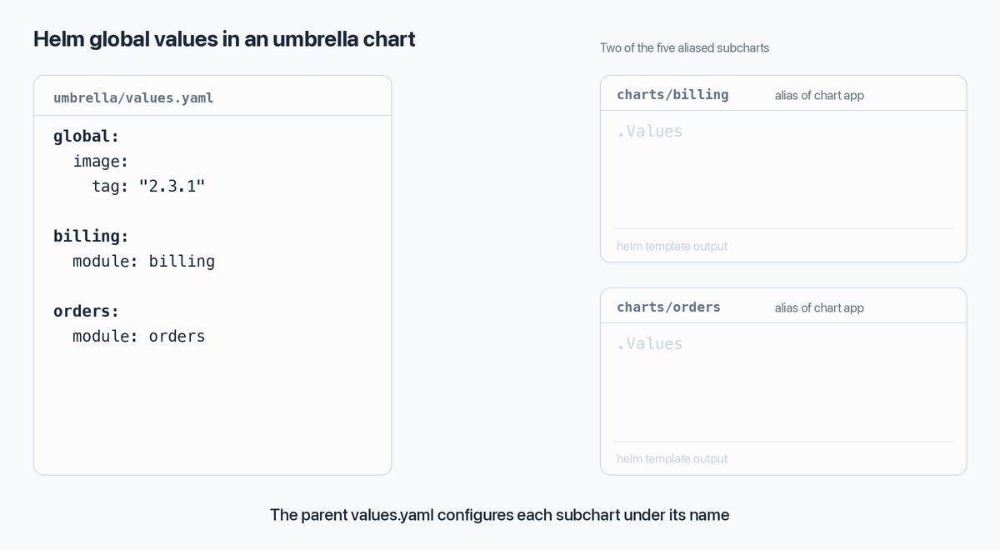

*__Blog Post Publish Date:__ 2026/11/19*

---

# Helm Global Values: The Right Way to Share Values with Subcharts

In Helm, __global values__ are the values under the reserved `global` key, and every chart and subchart can read them. Each subchart normally sees only its own block of values. In this post I explain why I took `global` for a naming convention, what Helm actually does with it, and how I used it to set one image tag for the five modules of an umbrella chart.

## Why I Thought `global` Was Just a Convention

I first saw `global` in the [External Secrets Operator chart](https://github.com/external-secrets/external-secrets/blob/main/deploy/charts/external-secrets/values.yaml). Its `global` block holds keys such as `podLabels`, `imagePullSecrets`, and `repository`, and a value set there applies to every deployment of the chart. Since the name suggests something that applies to everything, I took it as a naming convention with no mechanism behind it. Then I found the same block in Bitnami charts, such as the [Fluent Bit chart](https://github.com/bitnami/charts/blob/main/bitnami/fluent-bit/values.yaml#L15) with `imageRegistry` and `imagePullSecrets`, which reinforced that idea.

In a single chart, that is mostly true. The values reach every deployment because the chart's templates read `.Values.global`, and any other key name would work the same way. What I missed is that Helm treats `global` differently when a chart has subcharts. The comment above the Bitnami block hints at it, saying these values override the image parameters "including dependencies".

## What Helm Does with `global`

The [Helm documentation on subcharts and globals](https://helm.sh/docs/chart_template_guide/subcharts_and_globals/#global-chart-values) cleared it up for me. To see why `global` exists, start with how Helm scopes values in a parent chart, or umbrella chart, that declares other charts as dependencies.

The parent's `values.yaml` configures each subchart under a key with the subchart's name. Helm passes each subchart only its own block, without the prefix, so a subchart template reads `.Values.replicaCount`, not `.Values.mysubchart.replicaCount`. In the documentation's words, "a subchart cannot access the values of its parent."

`global` is the exception. Helm reserves `Values.global` for values that "can be accessed from any chart or subchart by exactly the same name", so a value under `global` in the parent reaches every subchart as `.Values.global.<name>`. A naming convention can't do that, because any other key in the parent is invisible to the subchart unless it sits in the subchart's block.

The [charts reference](https://helm.sh/docs/topics/charts/#global-values) adds three rules. Globals flow down to subcharts and their subcharts, never up, so a subchart can't change the parent's values. When the parent and a subchart define the same global, the parent wins. And globals must be declared explicitly, so you can't use an existing non-global key as a global.

Here is the same parent `values.yaml` seen from each side, for a subchart imported as `billing`:

| Where the value is set in the parent | Path in the parent templates | Path in the `billing` templates |
| --- | --- | --- |
| `replicaCount` at the root | `.Values.replicaCount` | Not visible |
| `billing.replicaCount` | `.Values.billing.replicaCount` | `.Values.replicaCount` |
| `global.image.tag` | `.Values.global.image.tag` | `.Values.global.image.tag` |

## Sharing One Image Tag Across Five Modules

`global` clicked for me with an internal application at work. I wrote a chart for it and an umbrella chart that imports that chart five times, one per application module, each with its own values. The umbrella works like a bounded context for the modules. All five run the same container image, and I didn't want to repeat the tag in every module's values.



The umbrella chart imports the application chart once per module with [`alias`](https://helm.sh/docs/topics/charts/#alias-field-in-dependencies), the dependency field for adding the same chart more than once. The names are examples, and the snippet shows two of the five modules:

```yaml
# umbrella/Chart.yaml
apiVersion: v2
name: my-app-bundle
version: 0.1.0
dependencies:
  - name: app
    alias: billing
    version: 0.1.0
  - name: app
    alias: orders
    version: 0.1.0
```

The tag lives once, under `global` at the root of the umbrella values. Each module block only has its own settings:

```yaml
# umbrella/values.yaml
global:
  image:
    tag: "2.3.1"

billing:
  module: billing

orders:
  module: orders
```

The application template uses the global tag when it is set and falls back to the chart's own value:

```yaml
# app/templates/deployment.yaml
image: "{{ .Values.image.repository }}:{{ .Values.global.image.tag | default .Values.image.tag }}"
```

The application chart also declares the global key in its `values.yaml`, with an empty default:

```yaml
# app/values.yaml
global:
  image:
    tag: ""

module: ""

image:
  repository: registry.example.com/my-app
  tag: "1.0.0"
```

Without that default, rendering the application chart alone fails, because `.Values.global.image` doesn't exist. With Helm v4.3.1, the error is:

```text
Error: app/templates/deployment.yaml:10:59
  executing "app/templates/deployment.yaml" at <.Values.global.image.tag>:
    nil pointer evaluating interface {}.image
```

With the default in place, `helm template` renders both modules with the global tag:

```bash
helm template rel ./umbrella | grep image:
```

```yaml
image: "registry.example.com/my-app:2.3.1"
image: "registry.example.com/my-app:2.3.1"
```

Bumping every module now takes one value, such as `--set global.image.tag=2.4.0`, and the application chart still works standalone with its own `image.tag`. To check which values each subchart receives after the merge, the JSON dump from [Helm Tips: Inspect Your Chart Context with JSON](/blog/2026/2026-02-25-helm-tips-inspect-context.md) shows `global` inside each subchart's `.Values`. For how I decide what to template in the application chart, see [Helm Charts: Development Practices from a Programmer's Perspective](/blog/2025/2025-02-25-helm-best-practices.md).

## Why YAML Anchors Were Not Enough

It took me a while to see this. Before, I shared parameters across module blocks with [YAML anchors](https://yaml.org/spec/1.2.2/#anchors-and-aliases), defining the tag once with `&tag` and referencing it with `*tag`. Anchors only resolve inside the file being parsed, so when I split the umbrella values into more than one file, a file passed with `-f` couldn't reference an anchor from another one. `global` doesn't have that limit, because Helm merges all values files before passing the global block to the subcharts.

## Key Takeaways

- `global` is a reserved key that any chart or subchart reads as `.Values.global.<name>`.
- Subcharts see only their own block of the parent's values, except for `global`.
- Inside a single chart, `global` is a regular value that reaches only the templates that read it.
- Globals flow from parent to subcharts, never up, and the parent's value wins.
- An umbrella chart that imports the same chart several times with `alias` can set a shared value, such as the image tag, once under `global`.
- A subchart that reads a global should declare it with an empty default, or it fails to render on its own.
- YAML anchors only resolve inside one file and break when values are split across files.

## References

- [Subcharts and Global Values (Helm)](https://helm.sh/docs/chart_template_guide/subcharts_and_globals/)
- [Charts: Global Values (Helm)](https://helm.sh/docs/topics/charts/#global-values)
- [Charts: Scope, Dependencies, and Values (Helm)](https://helm.sh/docs/topics/charts/#scope-dependencies-and-values)
- [Charts: Alias field in dependencies (Helm)](https://helm.sh/docs/topics/charts/#alias-field-in-dependencies)
- [YAML 1.2.2: Anchors and Aliases (YAML)](https://yaml.org/spec/1.2.2/#anchors-and-aliases)
- [External Secrets Operator chart values (External Secrets)](https://github.com/external-secrets/external-secrets/blob/main/deploy/charts/external-secrets/values.yaml)
- [Fluent Bit chart values (Bitnami)](https://github.com/bitnami/charts/blob/main/bitnami/fluent-bit/values.yaml#L15)

---

> *I'm Carlos Neto, and this blog is where I share my experiences and open source contributions. More about me on [my home page](/index.md). If you have questions or a different approach, contact me on [LinkedIn](https://www.linkedin.com/in/c-neto/).*

---

```{raw} html
<script type="application/ld+json">
{
  "@context": "https://schema.org",
  "@graph": [
    {
      "@type": "BlogPosting",
      "headline": "Helm Global Values: The Right Way to Share Values with Subcharts",
      "description": "How the global key in Helm values works, why it only matters with subcharts, and how I used it to share one image tag across five modules of an umbrella chart.",
      "datePublished": "2026-11-19",
      "inLanguage": "en",
      "url": "https://carlosneto.dev/blog/2026/2026-11-19-helm-global-values/",
      "mainEntityOfPage": "https://carlosneto.dev/blog/2026/2026-11-19-helm-global-values/",
      "image": "https://carlosneto.dev/_static/2026/2026-11-19/helm-global-values.gif",
      "keywords": ["Helm", "global values", "subcharts", "umbrella chart", "Kubernetes"],
      "author": {"@id": "https://carlosneto.dev/#person"}
    },
    {
      "@type": "Person",
      "@id": "https://carlosneto.dev/#person",
      "name": "Carlos Neto",
      "url": "https://carlosneto.dev/",
      "sameAs": ["https://www.linkedin.com/in/c-neto/", "https://github.com/c-neto"]
    },
    {
      "@type": "BreadcrumbList",
      "itemListElement": [
        {"@type": "ListItem", "position": 1, "name": "Home", "item": "https://carlosneto.dev/"},
        {"@type": "ListItem", "position": 2, "name": "Blog", "item": "https://carlosneto.dev/blog/"},
        {"@type": "ListItem", "position": 3, "name": "Helm Global Values: The Right Way to Share Values with Subcharts"}
      ]
    }
  ]
}
</script>
```
