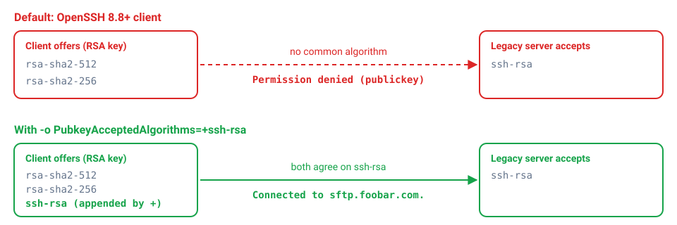

*__Publication Date:__ 2026/11/14*

---

# SFTP Permission Denied (publickey): How to Explicitly Set the Key Algorithm

An SFTP connection to a partner's server failed with `Permission denied (publickey)`. It took me about a week to learn that the key was fine. The real cause was the signature algorithm: since OpenSSH 8.8, the client no longer offers `ssh-rsa` (RSA with SHA-1) by default, and that server accepted nothing else. This post covers how I got there, how to confirm the cause with `ssh -vv`, and how to re-enable `ssh-rsa` for a single connection with `HostKeyAlgorithms` and `PubkeyAcceptedAlgorithms`.

## The Situation

I had to perform a manual operation on the SFTP server of a partner, a financial institution. The setup was conventional key pair authentication: I had the private key, and the public key was registered on their side. I connected with the `sftp` CLI, and it failed on the very first attempt:

```bash
$ sftp -i pk.pem john-doe@sftp.foobar.com

john-doe@sftp.foobar.com: Permission denied (publickey).
Connection closed
```

This was not a regression after an upgrade. It never worked, because I did not know about this behavior of recent OpenSSH clients. <!-- PERSONAL EXPERIENCE: first attempt failed, interview 2026-11-14 -->

## Where I Looked First (and Why It Was Wrong)

`Permission denied (publickey)` reads like a problem with the key, so I checked the key.

1. **File permissions.** My first suspicion was the permissions of `pk.pem`. OpenSSH refuses to use a private key that other users can read ([ssh(1)](https://man.openbsd.org/ssh)), so a loose mode is a common cause of this error. That was not it.
2. **The trailing newline.** Next, I suspected the private key file was missing the final empty line (EOL) at the end. A key copied from an email or a chat sometimes loses it, and the key can then fail to load. That was not it either.

The key, the user, and the file were all correct. The error message just does not say that the client never offered the key in a format the server accepts. After about a week of checking the wrong things, I found the explanation in a Stack Overflow thread about the same symptom against legacy servers. What I learned is that this error covers more causes than a bad key, for example a signature algorithm that one side refuses to use. <!-- PERSONAL EXPERIENCE: author's partner SFTP connection, interview 2026-11-14 -->

## Why Modern OpenSSH Rejects the Connection

A few terms first, because the error hides all of them:

- **SFTP** is the file transfer protocol that runs over an SSH connection, so it inherits SSH's key exchange and authentication.
- **`ssh-rsa`** is the signature algorithm that uses an RSA key with the SHA-1 hash.
- **`rsa-sha2-256` and `rsa-sha2-512`** are the signature algorithms that use the same RSA key with SHA-2.

OpenSSH 8.8 disabled RSA signatures using SHA-1 by default, on both the client and the server ([OpenSSH 8.8 release notes](https://www.openssh.com/txt/release-8.8)). An RSA key still works with modern clients, but only through `rsa-sha2-256` and `rsa-sha2-512`.

When a server only supports `ssh-rsa` signatures, a modern client has no signature algorithm in common with it for that key. The client skips the key, no other authentication method is left, and the server answers with the same generic `Permission denied (publickey)` you get for a wrong key, without a word about algorithms.



The same release notes explain why: chosen-prefix collision attacks on SHA-1 had become cheap enough to be practical.

## Diagnose: Check the Algorithms with `ssh -vv`

When I first wrote down this fix in my notes, I used `ssh -Q key john-doe@sftp.foobar.com`, thinking it asked the server which algorithms it supports. It does not: `ssh -Q` queries the algorithms supported by the local client, and the hostname is ignored ([ssh(1)](https://man.openbsd.org/ssh)). It is still useful to check what your client can do. This lists the signature algorithms your local OpenSSH supports, such as `rsa-sha2-512` or `ssh-ed25519`:

```bash
ssh -Q PubkeyAcceptedAlgorithms
```

And this prints the client version, which tells you whether the OpenSSH 8.8 default applies:

```bash
ssh -V
```

To see what happens with the server, run the connection in verbose mode. `sftp` passes `-v` through to `ssh`, but calling `ssh` directly gives the same handshake:

```bash
ssh -vv -i pk.pem john-doe@sftp.foobar.com
```

Things to look for in the output:

- **The host key algorithm the server offers** during key exchange. If the connection fails before authentication with an error that no matching host key type was found, the server only has an `ssh-rsa` host key.
- **`server-sig-algs`**, if the server sends it. It lists the public key signature algorithms the server accepts. A legacy server either does not send it or lists only `ssh-rsa`, without `rsa-sha2-256` or `rsa-sha2-512`.
- **Whether your key was offered at all.** If the client skips `pk.pem` instead of offering it, the client's `PubkeyAcceptedAlgorithms` is filtering it out.

For a view from outside, without authenticating, `nmap` can list the algorithms the server advertises with the [ssh2-enum-algos script](https://nmap.org/nsedoc/scripts/ssh2-enum-algos.html):

```bash
nmap -p 22 --script ssh2-enum-algos sftp.foobar.com
```

## The Fix: Explicitly Set the Algorithm

Once the cause is clear, the fix is two client options that add `ssh-rsa` back for this connection only. This is what I ran:

```bash
$ sftp -i pk.pem \
    -o HostKeyAlgorithms=+ssh-rsa \
    -o PubkeyAcceptedAlgorithms=+ssh-rsa \
    john-doe@sftp.foobar.com

Connected to sftp.foobar.com.
sftp>
```

What each option does, per [ssh_config(5)](https://man.openbsd.org/ssh_config):

| Option | What it controls | Why it matters here |
| --- | --- | --- |
| `HostKeyAlgorithms` | The host key algorithms the client accepts from the server | Needed when the server's host key is only `ssh-rsa` |
| `PubkeyAcceptedAlgorithms` | The signature algorithms the client uses for public key authentication | Lets the client sign with `ssh-rsa` so the server accepts the key |

Pay attention to the `+` prefix. It appends `ssh-rsa` to the default list, so the modern algorithms stay enabled and are still tried first. Without it, the value replaces the whole list.

`PubkeyAcceptedAlgorithms` is the current name of the option. Before OpenSSH 8.5 it was called `PubkeyAcceptedKeyTypes`, which still works as an alias ([OpenSSH 8.5 release notes](https://www.openssh.com/txt/release-8.5)), so older guides and Stack Overflow answers often use the old name.

### Scope It to One Host

I used the flags on the command line because this was a manual, one-off operation. If you connect to a legacy server regularly, the same settings can live in `~/.ssh/config`, limited to that host so every other connection keeps the secure defaults:

```text
Host sftp.foobar.com
    User john-doe
    IdentityFile ~/.ssh/pk.pem
    HostKeyAlgorithms +ssh-rsa
    PubkeyAcceptedAlgorithms +ssh-rsa
```

Avoid putting these lines under `Host *`, which would weaken every SSH connection on the machine.

### The Trade-Off

Re-enabling `ssh-rsa` means trusting SHA-1 signatures for that connection, which OpenSSH disabled on purpose. The long-term fix belongs to the server: supporting `rsa-sha2-256`/`rsa-sha2-512`, or an Ed25519 key, removes the need for the workaround. I did not contact the partner about it. If you depend on a server like this for recurring work, ask its owner to update it.

## Key Takeaways

- A modern OpenSSH client (8.8 or later) does not offer `ssh-rsa` (RSA/SHA-1) signatures by default, and a server that accepts only `ssh-rsa` answers with a generic `Permission denied (publickey)`.
- The error points at the key, so permissions and file formatting get checked first. They were not the problem in my case, and finding the real cause took me about a week.
- `ssh -Q` lists your local client's algorithms, not the server's. Use `ssh -vv` or `nmap --script ssh2-enum-algos` to see what the server offers.
- `-o HostKeyAlgorithms=+ssh-rsa -o PubkeyAcceptedAlgorithms=+ssh-rsa` re-enables the legacy algorithm for one connection. The `+` keeps the modern defaults.
- Use `PubkeyAcceptedAlgorithms`. `PubkeyAcceptedKeyTypes` is the pre-8.5 name and only survives as an alias.
- Scope the workaround to a single host. The real fix is a server that supports SHA-2 signatures.

## References

- [OpenSSH 8.8 Release Notes (OpenSSH)](https://www.openssh.com/txt/release-8.8)
- [OpenSSH 8.5 Release Notes (OpenSSH)](https://www.openssh.com/txt/release-8.5)
- [ssh_config(5) Manual Page (OpenBSD)](https://man.openbsd.org/ssh_config)
- [ssh(1) Manual Page (OpenBSD)](https://man.openbsd.org/ssh)
- [sftp(1) Manual Page (OpenBSD)](https://man.openbsd.org/sftp)
- [ssh2-enum-algos NSE Script (Nmap)](https://nmap.org/nsedoc/scripts/ssh2-enum-algos.html)

---

> *I'm Carlos Neto, and this blog is a brain dump of my career experience. More about me on [my home page](/index.md). If you have questions or a different approach, contact me on [LinkedIn](https://www.linkedin.com/in/c-neto/) or leave a comment below.*

---

```{raw} html
<script type="application/ld+json">
{
  "@context": "https://schema.org",
  "@graph": [
    {
      "@type": "BlogPosting",
      "headline": "SFTP Permission Denied (publickey): How to Explicitly Set the Key Algorithm",
      "description": "Why a modern OpenSSH client can fail with Permission denied (publickey) against a legacy SFTP server, how to confirm it with ssh -vv, and how to re-enable ssh-rsa for one connection.",
      "datePublished": "2026-11-14",
      "inLanguage": "en",
      "url": "https://carlosneto.dev/blog/2026/2026-11-14-sftp-explicit-algorithm/",
      "mainEntityOfPage": "https://carlosneto.dev/blog/2026/2026-11-14-sftp-explicit-algorithm/",
      "keywords": ["SFTP", "OpenSSH", "ssh-rsa", "PubkeyAcceptedAlgorithms"],
      "image": "https://carlosneto.dev/_static/2026/2026-11-14/ssh-rsa-negotiation.svg",
      "author": {"@id": "https://carlosneto.dev/#person"}
    },
    {
      "@type": "Person",
      "@id": "https://carlosneto.dev/#person",
      "name": "Carlos Neto",
      "url": "https://carlosneto.dev/",
      "sameAs": ["https://www.linkedin.com/in/c-neto/", "https://github.com/c-neto"]
    },
    {
      "@type": "BreadcrumbList",
      "itemListElement": [
        {"@type": "ListItem", "position": 1, "name": "Home", "item": "https://carlosneto.dev/"},
        {"@type": "ListItem", "position": 2, "name": "Blog", "item": "https://carlosneto.dev/blog/"},
        {"@type": "ListItem", "position": 3, "name": "SFTP Permission Denied (publickey): How to Explicitly Set the Key Algorithm"}
      ]
    }
  ]
}
</script>
```
