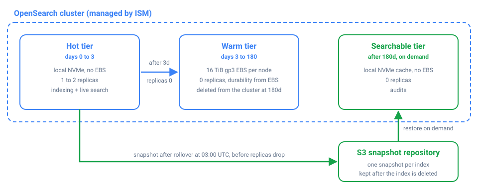

*__Blog Post Publish Date:__ 2026/11/20*

---

# How I Cut $8,000 a Month Off an OpenSearch Cluster by Rethinking Storage

This blog post covers how I cut $8,000 to $10,000 a month from a self-managed OpenSearch cluster with hot, warm, and searchable storage tiers, ending with the ISM policy that automates them and why I would use a single AZ today.

## The Bill Was in the Disks

<!-- [PERSONAL EXPERIENCE] -->
This started as a cost-reduction task force. The AWS bill at the company I worked for had grown too high, management asked the teams to cut costs, and the OpenSearch cluster I ran was one of the largest items on it. It was a self-managed, open source OpenSearch cluster with 10 hot data nodes and 14 warm data nodes, and every warm node had a 16 TiB gp3 EBS volume. That is 224 TiB of provisioned block storage on the warm tier alone.

<!-- [PERSONAL EXPERIENCE] -->
My first guess was compute. I expected the EC2 instances to dominate the bill, so before touching anything I analyzed the cost of the 24 data nodes line by line, separating compute from storage. The answer was EBS. It cost more than the instances and more than data transfer. The hot tier was oversized too, but the warm tier's volumes, provisioned for the whole retention window and holding replicated data, were where the money went.

So the job was to stop paying block-storage prices for data that did not need block storage. Logs from the last few hours are queried all the time and have to be fast, while logs from four months ago are read rarely, if ever, and I was paying the same price per GB for both.

Read this as a field report from one cluster. The savings came from risks I chose to accept for this workload, and your numbers and risk tolerance will be different, so the reasoning behind each decision is more useful than the exact setup.

## Three Tiers Matched to How the Data Is Read

I split the life of an index into three stages and gave each one the cheapest storage that still met its access pattern. Data stays on the hot tier for 3 days, moves to the warm tier until it is 6 months old, and after that exists only as a snapshot in S3.



Those thresholds came from how this organization used its logs. Live dashboards and alerts queried almost only the last couple of days, the warm window covered a typical investigation, and anything older was audit material. A security team might keep data hot for a week, and a team with strict compliance retention might keep warm data for a year. The exact numbers matter less than drawing the lines explicitly, because once each stage is defined, the storage decision for it follows.

The hot nodes run on EC2 instance types with local NVMe instance storage and no EBS at all. With no network hop between the node and its disk, they handle the heavy indexing and near-real-time search that fresh data needs. I covered this setup in [OpenSearch + EC2 Instance Store: A Disruptive Approach to Hot Tier Storage](/blog/2026/2026-11-08-opensearch-hot-instance-store.md). Instance storage has two real limits. Its capacity is fixed by the instance type and much smaller than what EBS offers, which is fine because the hot tier only holds 3 days of data. It is also ephemeral, so a replaced node comes back with an empty disk. To survive that, every hot index has one replica, sometimes two, so losing a node never means losing data. On the hot tier I pay for replication, and in exchange I get fast IO and fault tolerance. The cost per GB is high, but the tier is small, so the total stays under control.

## The Warm Tier Without Replicas

After 3 days, indexes move to the warm nodes. These nodes have a lot of memory and the largest gp3 volume available at the time, 16 TiB. AWS [raised the gp3 limit to 64 TiB](https://aws.amazon.com/about-aws/whats-new/2025/09/amazon-ebs-size-provisioned-performance-gp3-volumes/) in September 2025, but when I built this, 16 TiB was the ceiling. On this tier, capacity per node matters more than raw IO, because this is where months of data live.

Most of the savings came from one change. Indexes are created with one replica, or two when warranted, while they are hot. When an index reaches the warm tier, I set its replicas to zero and rely on the durability of the EBS volume instead.

EBS is network-attached, so the data does not die with the instance. When a warm node is rotated, a new node comes up, reattaches the volume, and its shards are back. A replica on the warm tier was protecting against a failure that EBS already covers, and it meant paying for two full copies of months of data on the most expensive line of the bill. Dropping the replicas cut the warm tier's disk usage at least in half. Keep in mind that an EBS volume belongs to a single Availability Zone, so the replacement node has to run in the same zone as the volume.

At some point I realized I was paying AWS for EBS and not trusting it. AWS documents gp3 durability as 99.8% to 99.9%, an annual failure rate of 0.1% to 0.2%, on the [Amazon EBS volume types](https://docs.aws.amazon.com/ebs/latest/userguide/ebs-volume-types.html) page. That risk is small but not zero, and I accepted it in exchange for the savings. What made the decision safe is that every index is snapshotted to S3 before it reaches the warm tier. If a warm volume is ever lost, the data is still in the bucket and I restore it from the snapshot.

<!-- [PERSONAL EXPERIENCE] -->
The trade-off I did feel in practice was availability. Without replicas, the shards on a warm node are unreachable while that node is replaced. It happened in production. A warm node was rotated, and its data was unavailable for about 10 minutes. That was the time it took for the old node to leave, the new one to come up and reattach the EBS volume, and the cluster to see its shards again. For data that is weeks or months old and read occasionally, 10 minutes of unavailability was an easy price. On a hot index taking live writes, it would not have been.

## The Searchable Tier on S3

After 6 months, the data leaves the cluster disks. Each index has had a snapshot in S3 since it rolled over, so the policy only deletes it from the warm nodes. S3 costs much less per GB than EBS, and at this age the data is only needed for the occasional audit.

Data in S3 is not searchable until someone restores it. When an audit needs it, I restore the snapshot as a [searchable snapshot](https://docs.opensearch.org/latest/tuning-your-cluster/availability-and-recovery/snapshots/searchable_snapshot/), an index that OpenSearch reads from the snapshot repository instead of copying it back to local disk. It runs on a dedicated node that also has no EBS, only local NVMe. That NVMe works as a cache in front of the snapshot. The authoritative copy stays in the bucket, and the node keeps locally only what it needs to answer queries quickly. Because the real data is safe in S3, these indexes are restored without replicas. If the searchable node dies, nothing is lost, and I restore again. The node roles and cache settings for this tier are in [OpenSearch Storage Tiering for Log Analytics: A Hands-On Guide](/blog/2026/2026-11-12-opensearch-hot-warm-cold.md).

> <i class="fa-solid fa-circle-info"></i> __Put a date in the rollover index name__
>
> Use a date as the rollover suffix, for example `logs-2026.02.14-000001`. When you hunt through months of snapshots in S3 for an audit, the name tells you roughly which period the index covers, without opening each one to check timestamps.

## The ISM Policy That Automates It

[Index State Management (ISM)](https://docs.opensearch.org/latest/im-plugin/ism/index/) is the OpenSearch plugin that moves indexes through states you define, running actions such as rollover, snapshot, or delete when transition conditions like index age are met. An ISM policy runs the whole lifecycle. This is a generic version of the one I used, without the notification blocks and internal identifiers:

```opensearch
PUT _plugins/_ism/policies/rollover-50gb-30d-snapshot-warm-3d-delete-180d
{
  "policy": {
    "description": "Roll over at 50GB primary shard or 30d. Set read-only, snapshot to S3 at 03:00, move to warm after 3d, disable replicas on warm, delete at 180d.",
    "ism_template": [
      {
        "index_patterns": ["logs-app*"],
        "priority": 80
      }
    ],
    "default_state": "wait-first-write",
    "states": [
      {
        "name": "wait-first-write",
        "actions": [],
        "transitions": [
          { "state_name": "rollover", "conditions": { "min_doc_count": "1" } },
          { "state_name": "rollover", "conditions": { "min_index_age": "30d" } }
        ]
      },
      {
        "name": "rollover",
        "actions": [
          {
            "rollover": {
              "min_primary_shard_size": "50gb",
              "min_index_age": "30d"
            }
          }
        ],
        "transitions": [
          { "state_name": "read-only" }
        ]
      },
      {
        "name": "read-only",
        "actions": [
          { "read_only": {} }
        ],
        "transitions": [
          {
            "state_name": "snapshot",
            "conditions": {
              "cron": {
                "cron": { "expression": "0 3 * * *", "timezone": "UTC" }
              }
            }
          }
        ]
      },
      {
        "name": "snapshot",
        "actions": [
          {
            "snapshot": {
              "repository": "my-s3-repository",
              "snapshot": "{{ctx.index}}"
            }
          }
        ],
        "transitions": [
          { "state_name": "warm", "conditions": { "min_index_age": "3d" } }
        ]
      },
      {
        "name": "warm",
        "actions": [
          {
            "allocation": {
              "require": { "temp": "warm" },
              "include": {},
              "exclude": {},
              "wait_for": false
            }
          }
        ],
        "transitions": [
          { "state_name": "disable-replicas" }
        ]
      },
      {
        "name": "disable-replicas",
        "actions": [
          {
            "replica_count": { "number_of_replicas": 0 }
          }
        ],
        "transitions": [
          { "state_name": "delete", "conditions": { "min_index_age": "180d" } }
        ]
      },
      {
        "name": "delete",
        "actions": [
          { "delete": {} }
        ],
        "transitions": []
      }
    ]
  }
}
```

Read top to bottom, the policy tells the story of one index. It waits in `wait-first-write` until the index receives its first document, with 30 days as a safety net, so ISM never rolls over an empty index. The `rollover` state starts a new write index once a primary shard reaches 50 GB or the index is 30 days old, and `read-only` freezes the old one. At 03:00 UTC, the `snapshot` state copies it to the S3 repository. Three days after the index was created, `warm` moves its shards to the nodes with the `temp: warm` attribute, and `disable-replicas` drops the replica count to zero. At 180 days, `delete` removes the index from the cluster, and the S3 snapshot remains for searchable restores.

The order of the states is what makes zero replicas acceptable. The snapshot is taken before the replicas are removed, so by the time the warm tier holds a single EBS-backed copy, an independent copy already exists in S3.

## What I Ended Up With

After the change, the cluster was no longer one pool of expensive EBS. It had three layers, each paying only for what its data needed:

| Tier | Storage | Redundancy | Durability from | Serves |
| --- | --- | --- | --- | --- |
| Hot | Local NVMe (no EBS) | Replicas (1-2) | In-cluster replication | Indexing and live search on recent data |
| Warm | 16 TiB gp3 EBS, high memory | No replicas | EBS volume durability | Indexed data for occasional reads |
| Searchable | S3, restored to an NVMe cache node (no EBS) | No replicas | S3 object durability | On-demand restores for audits |

The bill dropped by $8,000 to $10,000 a month. Nothing that mattered got slower, because the only data I made slower, or available only on demand, was data nobody queried in real time.

## What I Would Do Differently

<!-- [UNIQUE INSIGHT] -->
If I built a cluster from scratch today with cost and performance as the priorities, I would run it in a single Availability Zone.

Multi-AZ gives you availability, but it also means paying for [data transfer between zones](https://aws.amazon.com/ec2/pricing/on-demand/), and OpenSearch moves data between nodes all the time. Every write is replicated to the replica's node, and shards are relocated and recovered across the cluster. There are ways to reduce that traffic, but each one adds complexity. You can use a service mesh such as Istio so that data reaches an ingest node in its own zone and goes from there to a hot node in the same zone. On top of that, you need allocation rules. Even then, OpenSearch still sends replica copies to nodes in other zones, and that traffic is still billed. For a new cluster, I would rather run in one zone and rely on AWS for the durability of the data, through EBS and the S3 snapshots. The price is that the cluster is unavailable while that zone is down, and I accept it.

If you do run across zones, shard allocation awareness is mandatory.

> <i class="fa-solid fa-triangle-exclamation"></i> __Nodes in three AZs do not make the cluster multi-AZ__
>
> Spreading OpenSearch nodes across Availability Zones does not, by itself, protect your data from a zone failure. Running the cluster on Kubernetes does not change that. [OpenSearch, by default, allocates shard copies of a single shard across different nodes](https://docs.opensearch.org/latest/tuning-your-cluster/creating-a-cluster/#advanced-step-6-configure-shard-allocation-awareness-or-forced-awareness), and it has no idea which zone a node is in. A primary and its replica can land on two nodes in the same zone, and when that zone fails, both copies go with it.

Shard allocation awareness tells OpenSearch which node attribute represents a failure domain, so it can keep a shard's copies apart. Add a `zone` attribute to the `opensearch.yml` of each node, with the zone that node runs in, and enable awareness on that attribute:

```yaml
node.attr.zone: us-east-1a
```

```opensearch
PUT _cluster/settings
{
  "persistent": {
    "cluster.routing.allocation.awareness.attributes": "zone"
  }
}
```

With awareness, OpenSearch tries to place a shard's copies in different zones, but after a zone failure it still allocates replicas to the zones that remain. If you want copies never to share a zone, use forced awareness by listing every zone in `cluster.routing.allocation.awareness.force.zone.values`. The cluster then stays yellow until the missing zone comes back, instead of piling all the replicas onto the surviving nodes. Without one of these settings, a multi-AZ cluster pays cross-zone prices and still cannot survive the loss of a zone.

## Key Takeaways

- Break the cluster cost down before optimizing. In this cluster, the largest cost was EBS, not compute.
- Match storage to how data is read, with local NVMe and replicas for recent data, EBS for aging data, and S3 for archives.
- Replicas on an EBS-backed tier pay twice for durability that EBS already provides. Removing them from read-only warm data cut its disk usage at least in half.
- Zero replicas means unavailability while a node is replaced, about 10 minutes in this case, which is acceptable only for data that is rarely read.
- Snapshot every index to S3 before removing its replicas, so a lost EBS volume means a restore instead of data loss.
- Nodes spread across Availability Zones do not survive a zone failure unless shard allocation awareness is configured, because OpenSearch only separates shard copies across nodes by default.
- A single-AZ cluster avoids cross-zone data transfer cost and the complexity of reducing it, at the price of being unavailable when the zone is down.

## References

- [Index State Management (OpenSearch)](https://docs.opensearch.org/latest/im-plugin/ism/index/)
- [ISM policies (OpenSearch)](https://docs.opensearch.org/latest/im-plugin/ism/policies/)
- [Searchable snapshots (OpenSearch)](https://docs.opensearch.org/latest/tuning-your-cluster/availability-and-recovery/snapshots/searchable_snapshot/)
- [Creating a cluster, shard allocation awareness or forced awareness (OpenSearch)](https://docs.opensearch.org/latest/tuning-your-cluster/creating-a-cluster/#advanced-step-6-configure-shard-allocation-awareness-or-forced-awareness)
- [Amazon EBS volume types (AWS)](https://docs.aws.amazon.com/ebs/latest/userguide/ebs-volume-types.html)
- [Amazon EBS increases the maximum size and provisioned performance of gp3 volumes (AWS)](https://aws.amazon.com/about-aws/whats-new/2025/09/amazon-ebs-size-provisioned-performance-gp3-volumes/)
- [Amazon EBS pricing (AWS)](https://aws.amazon.com/ebs/pricing/)
- [Amazon EC2 On-Demand pricing (AWS)](https://aws.amazon.com/ec2/pricing/on-demand/)

---

> *I'm Carlos Neto, and I've been running OpenSearch on EKS for over five years. More about me on [my home page](/index.md). If you have questions or a different approach, contact me on [LinkedIn](https://www.linkedin.com/in/c-neto/).*

---

```{raw} html
<script type="application/ld+json">
{
  "@context": "https://schema.org",
  "@graph": [
    {
      "@type": "BlogPosting",
      "headline": "How I Cut $8,000 a Month Off an OpenSearch Cluster by Rethinking Storage",
      "description": "A field report on cutting $8,000 to $10,000 a month from a self-managed OpenSearch cluster by moving data from local NVMe to replica-free EBS to S3 searchable snapshots.",
      "datePublished": "2026-11-20",
      "inLanguage": "en",
      "url": "https://carlosneto.dev/blog/2026/2026-11-20-opensearch-storage-cost-savings/",
      "mainEntityOfPage": "https://carlosneto.dev/blog/2026/2026-11-20-opensearch-storage-cost-savings/",
      "image": "https://carlosneto.dev/_static/2026/2026-11-20/opensearch-storage-tiers.svg",
      "keywords": ["OpenSearch", "Amazon EBS", "Index State Management", "searchable snapshots", "cost optimization"],
      "author": {"@id": "https://carlosneto.dev/#person"}
    },
    {
      "@type": "Person",
      "@id": "https://carlosneto.dev/#person",
      "name": "Carlos Neto",
      "url": "https://carlosneto.dev/",
      "sameAs": ["https://www.linkedin.com/in/c-neto/", "https://github.com/c-neto"]
    },
    {
      "@type": "BreadcrumbList",
      "itemListElement": [
        {"@type": "ListItem", "position": 1, "name": "Home", "item": "https://carlosneto.dev/"},
        {"@type": "ListItem", "position": 2, "name": "Blog", "item": "https://carlosneto.dev/blog/"},
        {"@type": "ListItem", "position": 3, "name": "How I Cut $8,000 a Month Off an OpenSearch Cluster by Rethinking Storage"}
      ]
    }
  ]
}
</script>
```
